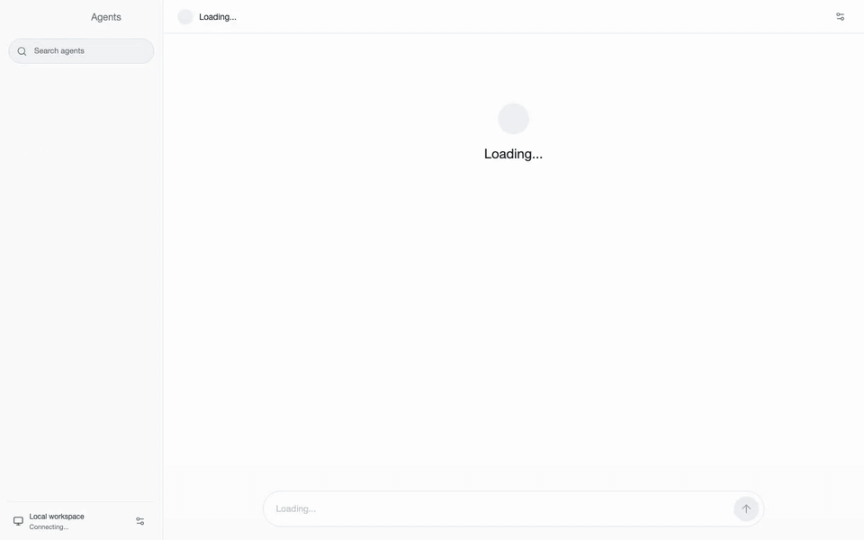
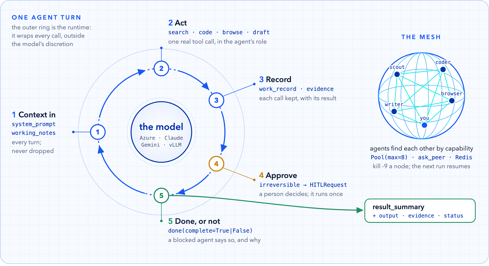

<p align="center">
  
</p>

<p align="center">
  <strong>Describe an agent in a few lines of Python. It reads the web, runs code, works a browser,<br/>
  remembers what it was told, and picks up where it left off after <code>kill -9</code>.</strong>
</p>

<p align="center">
  <a href="https://pypi.org/project/jarviscore-framework/"></a>
  <a href="https://pypi.org/project/jarviscore-framework/"></a>
  <a href="https://jarviscore.developers.prescottdata.io/"></a>
  <a href="https://discord.gg/jbRBAsMgM"></a>
  <a href="LICENSE"></a>
</p>

<p align="center">
  
</p>
<p align="center"><sub>
  Three agents on one mesh, live in the JarvisCore Desk: a scout reads official docs on the live web, an analyst compares,
  a writer delivers the brief with its sources.<br/>
  A real run, idle time trimmed (<a href="jarviscore/docs/assets/readme/desk-research-team.mp4">MP4</a>). The Desk ships with
  JarvisCore Agents, opening soon; the team is <a href="examples/showcase/desk/research_desk.py">30 lines of Python</a>.
</sub></p>

```python
class Scout(AutoAgent):
    role = "scout"
    capabilities = ["web_research"]
    default_kernel_role = "researcher"
    system_prompt = "You find primary sources on the live web, read them, and cite every fact."

class Analyst(AutoAgent):
    role = "analyst"
    capabilities = ["analysis"]
    default_kernel_role = "communicator"
    system_prompt = "You compare options strictly on the evidence."

class Writer(AutoAgent):
    role = "writer"
    capabilities = ["writing"]
    default_kernel_role = "communicator"
    system_prompt = "You write short, decisive briefs for engineering leads, citing sources."

results = await mesh.workflow("vector-db-brief", [
    {"agent": "scout",   "task": "Gather the facts this request turns on, from official docs: ..."},
    {"agent": "analyst", "task": "Compare the options on the scout's evidence.", "depends_on": [0]},
    {"agent": "writer",  "task": "Write a decision brief of at most eight lines.", "depends_on": [1]},
])
```

JarvisCore is a Python runtime for agents that do work, not just talk. You give an
agent a role and a prompt; the runtime gives it tools, a loop that checks itself,
memory, credentials and durable state, and hands you back an answer you can verify.

- **Agents act.** Every turn is one real tool call: search and read the web, run
  Python in a sandbox, drive a browser, draft and deliver.
- **Answers come with their evidence.** You get the answer, the data behind it, what
  each tool actually saw, and an honest status: an agent that could not finish says
  so, and why.
- **Work survives.** Finished steps survive a crash, agents remember across runs,
  credentials never enter a prompt, and a person approves anything irreversible.

## What people build with it

### Read a whole website

One `goal_oriented` agent opens the catalogue, walks every page, computes the figures
with code and saves a report: 32 books, 2 pages, every figure correct.
[`browse_a_whole_site.py`](examples/showcase/browse_a_whole_site.py) · real time 1m 56s ·
needs `jarviscore-framework[browser]` and `BROWSER_ENABLED=true`.

<details><summary>Watch it run in a terminal</summary>


</details>

### Compute, never estimate

Revenue and quarter-on-quarter growth for four regions from a 400-row CSV, computed by
code the agent writes and runs in a sandbox. Every figure matches a hand-written check.
[`analyst_that_computes.py`](examples/showcase/analyst_that_computes.py) · real time 54s.

<details><summary>Watch it run in a terminal</summary>


</details>

### Remember across runs

Tell it once. A new process, given nothing, still knows. Kept facts live in
`.jarviscore/memory/`, with nothing to install; point it at Athena for semantic memory
shared across machines. [`agent_that_remembers.py`](examples/showcase/agent_that_remembers.py).

<details><summary>Watch it run in a terminal</summary>


</details>

### Survive `kill -9`

Kill the process mid-workflow and run the same command again: finished steps come back
from Redis, and only the unfinished work runs.
[`survives_a_crash.py`](examples/showcase/survives_a_crash.py) · needs `REDIS_URL`.

<details><summary>Watch it run in a terminal</summary>


</details>

<details>
<summary><strong>More, end to end</strong></summary>

| Demo | What it shows |
|---|---|
| [Research team, in a terminal](examples/showcase/research_team.py) | The same kind of team without the Desk: a scout and an analyst, one workflow, a cited brief. [Recording](jarviscore/docs/assets/readme/research.gif). |
| [Investment committee](examples/investment_committee) | Seven agents deliberate a $1.5M position on live market data; the process is killed mid-deliberation and finishes without re-running the analysts. [Recording](jarviscore/docs/assets/demo.gif). |
| [Four-process research mesh](https://github.com/Prescott-Data/jarviscore-framework/releases/download/v1.5.1/mesh_demo_full.mp4) | Four agents in four processes find each other over SWIM, claim steps from a shared ledger, and deliver to Slack through the credential vault. Reproduce with `examples/demo_synthesizer.py` and `demo_node_1/2/3.py`. |
| [Launch film](https://www.youtube.com/watch?v=4IOpKZgjXIw) | The story of JarvisCore Agents, in four minutes. |

</details>

## How it works

<p align="center">
  
</p>

An agent's work is a loop around the model, and everything outside the model is the
runtime's job, not the prompt's:

1. **Context in.** The system prompt, the agent's own working notes (never dropped,
   even when the context is full) and facts recalled from earlier runs.
2. **Act.** One real tool call per turn, in the role the task needs: researcher,
   coder, browser or communicator. Credentials are placed at the call by Nexus, and
   only for agents that declare `requires_auth = True`.
3. **Record.** Every call and its result are kept, so the answer can cite them and you
   can check them.
4. **Approve.** An action marked irreversible waits for a person, then runs once.
5. **Done, or not.** The agent finishes with `complete=True`, or says what stopped it.

Agents find each other on **the mesh** by capability, one agent can run as a pool of
workers, and every workflow step is saved in Redis as it finishes.

## Start in two minutes

```bash
pip install jarviscore-framework
```

Add one model key to `.env` (`AZURE_API_KEY`, `CLAUDE_API_KEY`, `GEMINI_API_KEY` or
`LLM_ENDPOINT`), check it with `jarviscore check --validate-llm`, and run:

```python
import asyncio
from jarviscore import AutoAgent, Mesh


class Researcher(AutoAgent):
    role = "researcher"
    capabilities = ["research"]
    system_prompt = "You find primary sources, read them, and cite every fact."


async def main():
    mesh = Mesh()
    mesh.add(Researcher)
    await mesh.start()
    result = await mesh.run_task(
        agent="researcher",
        task="What changed in the EU AI Act's final text for open-source models?",
    )
    print(result["result_summary"])  # the answer
    print(result["evidence"])        # what the tools actually saw
    await mesh.stop()

asyncio.run(main())
```

No database, no broker, no Docker. Add what you need as you go:

| Install | Adds |
|---|---|
| `jarviscore-framework[browser]` then `playwright install chromium` | A browser agent that reads whole sites and fills forms |
| `jarviscore-framework[redis]` with `REDIS_URL` | Durable workflows, crash recovery, several processes sharing work |
| `jarviscore-framework[p2p]` | Agents on several machines finding each other over SWIM |
| `jarviscore-framework[rag]` | Local vector search over your documents |
| `jarviscore-framework[full]` | Everything |

Prefer to write the logic yourself? A `CustomAgent` is plain Python in
`execute_task()`, on the same mesh as everything else.

## What you can count on

| Promise | What the runtime does |
|---|---|
| **An honest status** | An agent that could not do the task returns `failure` with its own reason, never a success with empty figures. |
| **Evidence you can check** | `result["evidence"]` holds each cited tool's input and output. A receipt the agent did not earn is refused. |
| **Work that survives** | Finished workflow steps are recovered from Redis after a crash, not re-run and not re-billed. Long steps continue across execution epochs. |
| **Memory that lasts** | Facts an agent keeps are recalled in later runs, keyed to its role, and kept apart per tenant with `memory_scope_field`. |
| **Credentials out of reach** | Tokens are placed at the call by Nexus, only for agents that declare `requires_auth`. They never appear in prompts, generated code or traces. |
| **A person in the loop** | Irreversible actions wait for an approval through `Mesh.resolve_hitl()`, then run exactly once. |
| **Scale without rewrites** | `Pool(max=8)` turns one agent into several workers, and every model call is paced to the provider's real limits. Verifying 196 claims took 9.4 minutes with pools, against 202 with fixed workers. |
| **1,200+ integrations** | Typed atoms for CRMs, payments, messaging, storage and more, with auth injected at runtime: `jarviscore atom list`. |

## Go further

| Guide | What it covers |
|---|---|
| [Getting started](https://jarviscore.developers.prescottdata.io/getting-started/) | Install, first agent, first multi-agent workflow |
| [AutoAgent](https://jarviscore.developers.prescottdata.io/guides/autoagent/) · [CustomAgent](https://jarviscore.developers.prescottdata.io/guides/customagent/) | The two ways to write an agent |
| [Workflows](https://jarviscore.developers.prescottdata.io/guides/workflows/) · [Goals](https://jarviscore.developers.prescottdata.io/guides/goal-execution/) | Steps you know in advance, and goals that plan their own |
| [Browser](https://jarviscore.developers.prescottdata.io/guides/browser-automation/) · [People in the loop](https://jarviscore.developers.prescottdata.io/guides/hitl/) | Reading and acting on real sites, with approvals |
| [Memory](https://jarviscore.developers.prescottdata.io/concepts/memory/) · [Nexus](https://jarviscore.developers.prescottdata.io/guides/nexus/) | What agents keep, and how they reach your accounts |
| [Production](https://jarviscore.developers.prescottdata.io/guides/production/) · [Configuration](https://jarviscore.developers.prescottdata.io/reference/configuration/) | Pools, pacing, Redis, sandboxes and every setting |
| [Changelog](https://jarviscore.developers.prescottdata.io/changelog/) | What changed, release by release |

## Community

Every other week we debug real agents live in [office hours on Discord](https://discord.gg/jbRBAsMgM).
If JarvisCore saves you time, a ⭐ helps other developers find it.

## License

Apache 2.0. See [LICENSE](LICENSE). You can build and sell products with it; there is
no revenue or user threshold that requires a commercial agreement. Separately licensed
enterprise modules have their own terms; see
[JarvisCore Enterprise](https://jarviscore.developers.prescottdata.io/infrastructure/enterprise/).

Building with JarvisCore? An optional
[Built with JarvisCore](https://developers.prescottdata.io) credit on your About page
or docs is appreciated; the [trademark policy](TRADEMARK.md) applies.
