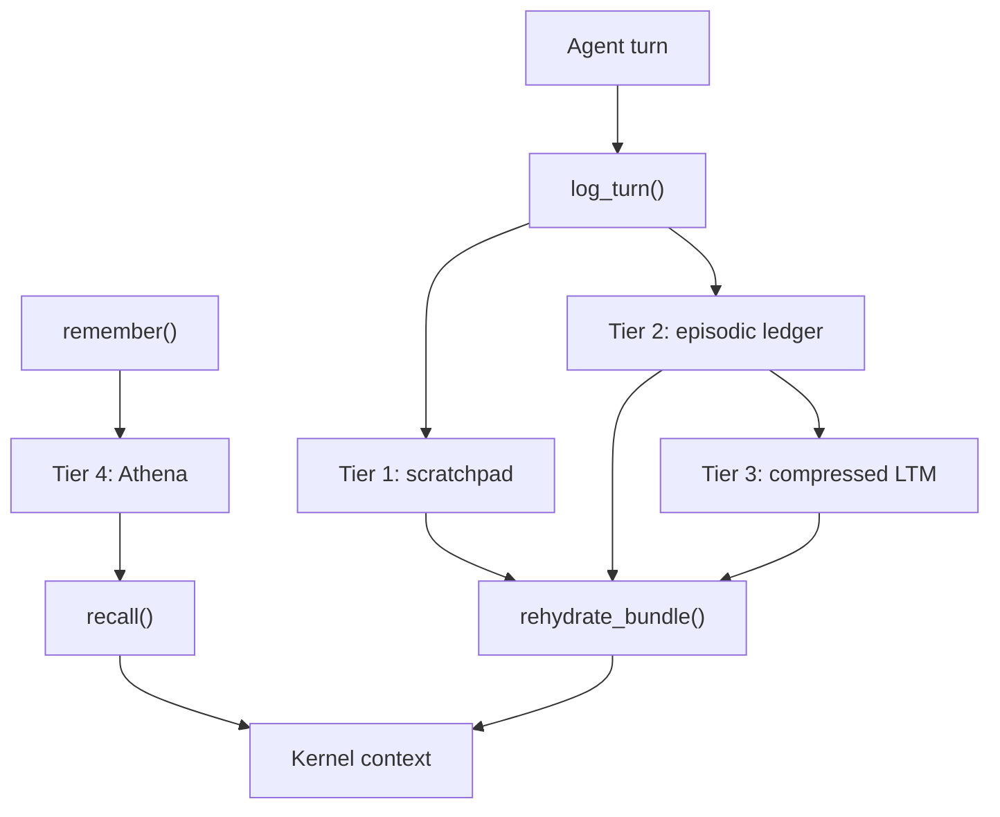

# Memory

JarvisCore agents maintain state across OODA loop turns through a four-tier memory system. Each tier serves a distinct purpose: fast in-turn working state, a durable audit trail, compressed long-horizon context, and cross-session semantic recall.

The tiers compose automatically. You interact with all of them through a single object: `UnifiedMemory`.

---

## The Four Memory Tiers



### Tier 1: Working Scratchpad

The `WorkingScratchpad` holds the agent's working notes for the current workflow step. It is backed by blob storage (local filesystem or Azure Blob) and is scoped to a single `(workflow_id, step_id, agent_id)` tuple.

An agent sees at least its last ten exchanges; older ones leave view five at a time, so anything it established earlier in a long step is kept by writing it down. Alongside any action, the agent writes what it has established: in the `working_notes` argument every function accepts under native tool calls, or as `NOTE: <fact>` lines (or `"notes": [...]` in the JSON protocol) on the text protocol; a note costs no turn. Each note is appended to the scratchpad. On the text protocol every note is shown at the top of every later turn as **MY WORKING NOTES**. Under native tool calls a note is read in the call that carried it while that call is in view, and joins **MY WORKING NOTES** once the call leaves; a runtime notice tells the agent a turn or two before exchanges leave, so it notes only what it will still need. That block is never withheld under context pressure. The notes are part of the step's checkpoint, so a step that continues in a new execution epoch keeps them.

Every call to `UnifiedMemory.log_turn()` also appends the turn (thought, action and the whole result) to the scratchpad as an audit record; these turn entries are not shown back to the agent.

The scratchpad is scoped to its step. Entries written with `scope="goal"` are promoted into the goal's truth when an `AutoAgent` goal step completes; use the Episodic Ledger and LTM for other cross-step continuity.

**Activates when:** `blob_storage` is provided to `UnifiedMemory`.

### Tier 2: Episodic Ledger

The `EpisodicLedger` is an append-only, ordered log of every turn event in a workflow. It is backed by a Redis Stream (key: `ledgers:{workflow_id}`) with a default TTL of seven days.

Each entry records the turn ID, timestamp, thought, action, result, and token count. The ledger is the chronological record of a workflow's turns while it is kept; it expires with the TTL and is not tamper-evident.

During context assembly, the Kernel reads the last N entries via `tail(count)` rather than the full history, keeping the context window bounded regardless of how long the workflow runs.

**Activates when:** `redis_store` is provided to `UnifiedMemory`.

### Tier 3: Long-Term Memory

`LongTermMemory` stores compressed summaries of episodic history. When a workflow accumulates enough turns that including the full ledger would exceed the context window, the Kernel calls `LongTermMemory.compress()`, which uses the LLM to distil the episodic entries into a compact narrative.

The summary is written to two stores simultaneously:

- Redis (key: `ltm:{workflow_id}`, seven-day TTL) for fast retrieval on the hot path.
- Blob storage (`workflows/{wf_id}/ltm/summary.txt`) as a durable backup with no expiry.

On `load_summary()`, Redis is tried first. If the key has expired (for example after a crash and Redis restart), the summary is read from blob storage and the Redis cache is repopulated.

**Activates when:** both `redis_store` and `blob_storage` are provided to `UnifiedMemory`.

### Tier 4: Cross-session memory (local store or Athena)

Tiers 1 to 3 belong to one workflow. Tier 4 is what an agent keeps from one
session to the next: the facts it chooses to keep with `remember()`, recalled
with `recall()` and, before every task, by relevance to that task.

It is kept under the agent's stable identity: its `role`, or the `agent_id` you
pass to the constructor. A generated `agent_id` (`researcher-1a2b3c4d`) is not
used, because it changes with every process. When the Mesh separates tenants
with `memory_scope_field`, each tenant has its own memory, and a step that
names no tenant gets none.

**Local store (default).** With no Athena configured, kept facts are appended
to `.jarviscore/memory/<identity>.jsonl` (with `__<tenant>` when scoped).
Recall scores facts by the words they share with the query: exact and cheap,
not semantic. Set `Mesh(config={"local_memory": False})` to turn it off.

**Athena MemOS.** Athena is an external memory service that replaces the local
store with semantically searchable memory shared across machines.

How Athena works decides how JarvisCore uses it:

| What Athena does | What follows for JarvisCore |
|---|---|
| Keeps each session's recent events as short-term memory (Redis) | An agent sees its own recent events directly |
| Follows the conversation (`user` messages), splits it where the topic changes, summarises each part and embeds it (MongoDB and Milvus) | What should become searchable memory is written as conversation and outcomes, not as a stream of thoughts |
| Searches every agent's summaries under one tenant and one scope (Athena's `user_id`) | Agents that share a scope share memory; agents that should not, must not share a scope |
| Isolates tenants, and nothing finer: metadata filters are not access control | Private material is never written to a shared scope |

When Athena is configured, it holds what lasts beyond a session: the outcomes
an agent reports and the facts it chooses to keep with `remember()`. Individual
turns are not written there; they stay in the step's scratchpad and episodic
ledger, which recover a session after a crash. `recall()` searches Athena by
relevance, and also returns facts kept so recently that Athena has not indexed
them yet, labelled as such. On `rehydrate_bundle()`, the Kernel receives
`athena_context`, which includes recent STM events and the highest-heat MTM
chains, so an agent restarted after a crash recovers not just its last
checkpoint but what earlier sessions established.

**Activates when:** the local store, whenever blob storage or Redis is
available and Athena is not; Athena, when `ATHENA_URL` is set and
`athena_client` is passed to `UnifiedMemory`.

### Memory in a room

Work in a [room](../guides/rooms.md) and the room's conversation remember in the room, with no configuration:

- **One memory per room.** Every step of work in a room, and every turn of its room agent, uses the room's tenant as Athena's tenant and the room as the scope. Whatever any agent keeps while working in the room, every agent working in the room later recalls. Nothing crosses to other rooms or tenants.
- **The team's memory.** What people say to the room's agent, its replies to everyone, and what the room records (requests, finished work, decisions and their reasons) are written to the room's team session in Athena, as the conversation Athena is built to follow. "Sam owns support", said once in a thread, is recalled by an agent writing the support section a week later.
- **Private stays private.** What a piece of work learns through its asker's own access to a system the room does not share is kept in that person's private memory in the room, never the room's. Only work done for them recalls it, and work that recalls it is private work: its result is held for them like any other. Replies and work shown to one person are never written to the team's memory.
- **Without Athena.** What agents keep in a room goes to the local store (`.jarviscore/memory`), scoped to the room, and what work learns through someone's own access goes to that person's private file in the room, with the same privacy rule. The team's conversation is remembered only in Athena. The local store is on one machine, in one working directory: a room worked on by several processes or machines needs Athena.

- **Forgetting.** `await room.forget(by=owner)` erases everything the room remembers: the team's memory and every person's private memory in it, including people who have since left. `await room.forget_person(person, by=person)` erases one person's private memory in the room; the person or an owner can do it. Athena removes sessions, events, summaries, vectors, payloads and the long-term knowledge they produced. Both erase the local store as well; with Athena configured, they raise unless Athena confirms. Call `forget` before `room.delete`, which removes the room's record of who had private memory in it.

Outside rooms, `Mesh(config={"memory_scope_field": "..."})` names the context field that separates your tenants; without it, an agent's memory is one pool. To erase a scope there, call `AthenaClient.erase_memory(tenant_id, user_id, agent_id="")`; leave `user_id` empty to erase a whole tenant.

---

## UnifiedMemory API

`UnifiedMemory` is the single object the Kernel uses for all memory operations. It is instantiated by the Mesh during agent setup; you do not construct it directly in normal usage.

```python
from jarviscore.memory import UnifiedMemory

mem = UnifiedMemory(
    workflow_id="wf-abc123",
    step_id="step-1",
    agent_id="researcher",
    redis_store=redis_store,        # Optional: enables Tiers 2 and 3
    blob_storage=blob_storage,      # Optional: enables Tiers 1 and 3
    athena_client=athena_client,    # Optional: enables Tier 4
)
```

### log_turn

Records a single OODA loop turn to the scratchpad and the episodic ledger. Turns are not written to Athena: what persists across sessions is what the agent chooses to `remember`.

```python
await mem.log_turn(
    turn_id="t1",
    thought="Identifying relevant data sources for the market analysis.",
    action="http_get",
    result="200 OK, retrieved 42 records",
    tokens=1240,
)
```

| Parameter | Type | Description |
|---|---|---|
| `turn_id` | `str` | Unique identifier for this turn within the step (e.g. `"t1"`, `"t2"`) |
| `thought` | `str` | The Kernel's reasoning text for this turn |
| `action` | `str` | The action taken: tool name, sub-agent call, or decision type |
| `result` | `str` | The outcome or observation returned by the action |
| `tokens` | `int` | Token count used this turn, for budget tracking |

### save_checkpoint

Saves a JSON snapshot of the Kernel's internal state to Redis. Used for crash recovery.

```python
await mem.save_checkpoint(json.dumps(kernel_state))
```

### load_checkpoint

Loads the most recent checkpoint from Redis.

```python
state_json = await mem.load_checkpoint()
if state_json:
    kernel_state = json.loads(state_json)
```

### rehydrate_bundle

Assembles the full context bundle for Kernel cold-start or crash recovery. Returns a dict with the following keys:

| Key | Type | Source |
|---|---|---|
| `ltm_summary` | `str` or `None` | LongTermMemory: compressed narrative |
| `recent_turns` | `list` | EpisodicLedger: last N turns |
| `checkpoint` | `str` or `None` | Redis: last Kernel state snapshot |
| `scratchpad` | `str` | WorkingScratchpad: current working notes |
| `athena_context` | `dict` or `None` | Athena: STM events and MTM chains |

```python
bundle = await mem.rehydrate_bundle(ledger_tail=10)
```

The `ledger_tail` parameter controls how many recent episodic entries are included. The default is `10`. Increase it for tasks that require broader recent context; decrease it if you are operating under a strict token budget.

---

## Tier Degradation

`UnifiedMemory` degrades gracefully when storage backends are absent. The active tiers at runtime depend on what was provided to the constructor.

| `redis_store` | `blob_storage` | `athena_client` | Active tiers |
|---|---|---|---|
| Not set | Not set | Not set | None (pure in-process run) |
| Set | Not set | Not set | Episodic Ledger, local cross-session store |
| Not set | Set | Not set | Working Scratchpad, local cross-session store |
| Set | Set | Not set | Scratchpad, Episodic Ledger, LTM, local cross-session store |
| Set | Set | Set | Scratchpad, Episodic Ledger, LTM, Athena |

A `Mesh` provides local blob storage by default, so an agent run through a Mesh
always has the scratchpad and the local cross-session store.

When a tier is inactive, all writes to it are no-ops and all reads return empty defaults. The Kernel continues to function correctly; it simply has less historical context available.

---

## The AthenaMemory Bridge

`AthenaMemory` is the per-agent object that manages the Athena STM/MTM session. It is created lazily the first time `UnifiedMemory._get_athena_memory()` is awaited.

You can use `AthenaMemory` directly for lower-level Athena operations:

```python
from jarviscore.memory import get_athena_client, AthenaMemory

athena = get_athena_client()
if athena:
    am = await AthenaMemory.create(
        agent_id="researcher",
        client=athena,
        redis_store=redis_store,
    )
    await am.on_task_assigned("task-1", "Analyse Q1 revenue trends", "researcher")
    ctx = await am.get_memory_context(limit=15)

    event_id = await athena.store_event_with_id(
        am.session_id,
        "agent",
        "observation",
        "Q1 analysis completed",
        {"workflow_id": "q1-analysis"},
        payload=b'{"revenue_growth": 0.18}',
        mime_type="application/json",
    )
    related = await athena.search_memory(
        am.session_id,
        "prior revenue analysis",
        metadata_filter={"origin_service": "jarviscore"},
    )
```

The `get_athena_client()` factory reads `ATHENA_URL`, `ATHENA_TENANT_ID`,
`ATHENA_HTTP_TIMEOUT`, `ATHENA_API_KEY`, and `ATHENA_JWT_TOKEN` from the
environment and returns `None` if `ATHENA_URL` is not set. This lets you safely
call it unconditionally and treat the result as optional.

---

## Setting Up Athena

Athena runs as a Docker-composed stack. `jarviscore memory init` pulls the published Athena image and starts it with its backing services.

```bash
jarviscore memory init
```

It finds a model key in your environment (Gemini, Azure OpenAI, or OpenAI; Athena has no Anthropic provider), creates an API key for Athena, starts the stack, waits for Athena's health endpoint, and writes `ATHENA_URL` and `ATHENA_API_KEY` to `.env`. Then check every tier:

```bash
jarviscore memory status
```

Athena needs two models: a chat model to summarise conversation, and an embedding model to search it. With Azure OpenAI, Athena calls the deployment URLs it is given, so `memory init` builds them from `AZURE_OPENAI_ENDPOINT` and two deployments, and checks both answer before starting:

| Variable | Default | |
|---|---|---|
| `ATHENA_AZURE_CHAT_DEPLOYMENT` | `gpt-4o-mini` | Any chat deployment. A reasoning deployment (gpt-5 and later, o-series) is detected and Athena is told to send the parameters it accepts; that needs an Athena image with reasoning-model support |
| `ATHENA_AZURE_EMBEDDING_DEPLOYMENT` | `text-embedding-3-small` | 1536 dimensions (`ATHENA_VECTOR_DIMENSION`) |

!!! warning "If memory never becomes searchable"
    Look at Athena's log (`docker logs athena`) for embedding or summarisation errors: a rejected key or a missing deployment makes Athena keep events but never summarise them, and nothing says so to the agents. The stack also sizes Athena's short-term memory above the count that forces a summary (`ATHENA_STM_MAX_EVENTS=60`, `ATHENA_STM_FLUSH_EVENTS=20`); with Athena's own defaults (10 and 20) events older than the newest ten are dropped before they are ever summarised.

What Athena does not do, so JarvisCore does not rely on it: time-range queries, and de-duplicating a repeated write. Erasing memory (`room.forget`, `AthenaClient.erase_memory`) needs an Athena image with memory erasure; older images answer it with an error, which JarvisCore raises rather than reporting the memory as erased.

!!! info "Athena's API key"
    Athena refuses requests without a key. JarvisCore serves many tenants (each room is one), so it holds a **service key**: Athena trusts it to name the tenant in each request. The stack starts Athena with `ATHENA_API_KEY` as its service key, and JarvisCore sends it on every call. Treat it like a database password, and in production keep Athena on a private network. Athena's own guide covers tenant keys and JWTs for other clients.

!!! note "Developing Athena itself"
    Run `jarviscore memory init --from-source` to build from `ATHENA_DIR`,
    `~/athena`, or a sibling Athena checkout instead of pulling the image.

---

## Managing Agent Memory via the CLI

The `jarviscore memory` command group provides operational access to agent memory state at runtime.

```bash
# Inspect recent STM events and MTM chains for an agent
jarviscore memory context --agent researcher

# Semantic search across an agent's full memory
jarviscore memory search --agent researcher --query "market analysis findings"

# Check health of all memory tiers
jarviscore memory status
```

See the [CLI Reference](../reference/cli.md) for the complete argument specification for each subcommand.

---

## Further Reading

- [Athena MemOS (GitHub)](https://github.com/Prescott-Data/athena): Open-source memory operating system with an STM/MTM/LTM pipeline, vector store, and knowledge graph
- [CLI Reference: memory](../reference/cli.md#jarviscore-memory): Full argument specification for `jarviscore memory` subcommands
- [Architecture Overview](architecture.md): How memory fits into the OODA loop and the Kernel execution model
