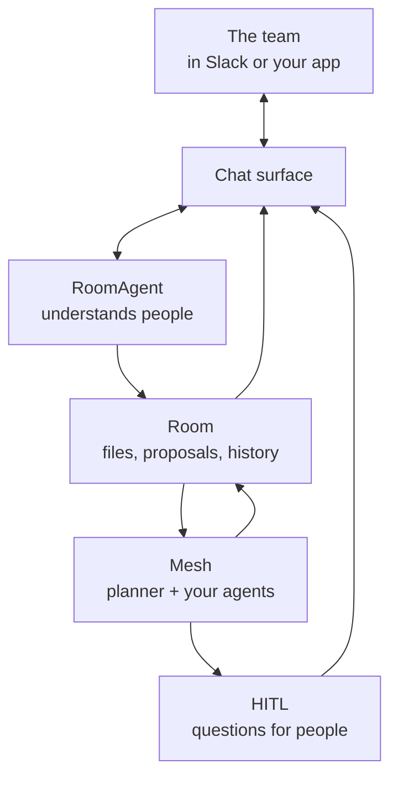
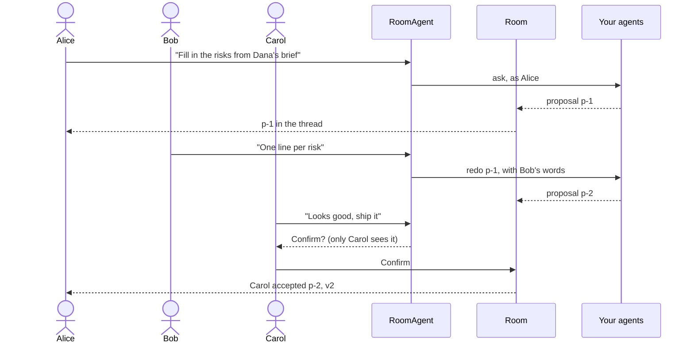
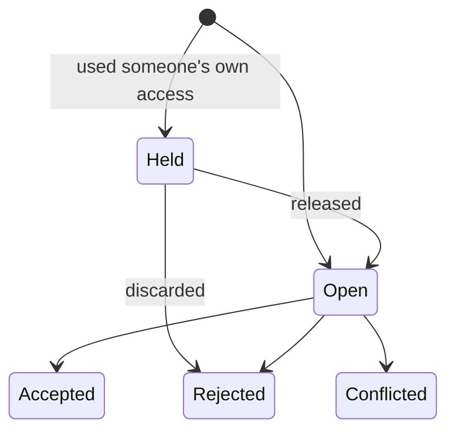

# Multiplayer

Most AI tools are single-player. One person talks to one assistant in a private session, then copies the result into a document or a chat and asks colleagues what they think. Every handoff runs through that person, the assistant forgets the conversation when the tab closes, and nobody else sees the work while it happens.

Multiplayer means a team and its agents work on the same work, in the same place, at the same time. Anyone on the team can ask the agents for something. Everyone sees what they are doing. People review, change and decide, and the agents act on what they say. When the agents need a person, they ask the people who are there. What was decided, and why, stays with the work.

JarvisCore provides this as wiring. You build the agents that do the work; the framework provides the shared workspace, the agent the team talks to, identity, permissions, people in the loop, delivery to chat, and the guarantees that make it safe in a team. This page explains the model. To build one, follow [Build a Multiplayer Agent](../guides/multiplayer-agents.md).

## The pieces

**A tenant** is a company, a team or a customer of your product. Everything multiplayer lives in a tenant: its people, its rooms, its questions. Nothing crosses from one tenant to another.

**People** are `Person`s in a tenant. A surface authenticates someone (the Slack user who posted, the user your app signed in) and that account resolves to a person. The same human on two surfaces can be linked into one person.

**A room** holds the shared work: a set of files, such as a launch plan, a contract draft, website copy, a dataset or code. Nothing in it is specific to software. Nobody writes to a room directly. Agents and people make **proposals**, and the room changes only when someone accepts one. A room is private to its members until its owner opens it to the tenant.

**Your agents** do the work. Asking a room for something runs an ordinary JarvisCore goal: the mesh planner breaks it into steps, your AutoAgents and CustomAgents claim them, and each step works in its own copy of the room's current files. What the steps change comes back as one proposal.

**The room agent** is who the team talks to. A `RoomAgent` reads each message with the thread it belongs to and works out what the person means: a request for work, feedback on a proposal, a decision, a pasted rewrite, an answer for the agents, or a conversation between colleagues that is none of its business. It is an AutoAgent with one extra Kernel role, so it reasons, remembers and is traced like your other agents.

**People in the loop.** When the work needs a person, it asks through JarvisCore's HITL store: a step the planner routed to a [human peer](../guides/human-peers.md), or an agent that stopped to ask for sign-off. The question appears in the thread of the work that raised it, and the team answers it there.

**A chat surface** is where the team already talks. JarvisCore supports Slack natively. Your product's own UI, Microsoft Teams, Discord or anything else is a small adapter you write against `ChatSurface`.

## How a piece of work flows

1. Alice mentions the bot in the team's channel: "Can you fill in the risks in the launch plan from Dana's brief?" The room agent asks the mesh's agents, as Alice. Her message becomes the thread where everything about this work appears.
2. The planner makes a plan and a writer agent takes the step. The thread shows the plan and each step as it happens. The writer's change arrives as a proposal with its diff and an Accept button.
3. Bob replies "Too wordy. One line per risk, and say Sam handles support." The room agent has the agents redo it with Bob's words, exactly as he wrote them. Nothing is turned down; the new proposal arrives in the same thread and replaces the old one once accepted.
4. Carol replies "Looks good, ship it." The room agent does not accept anything. It prepares the decision, and Carol alone is asked to confirm it with one tap. Her tap accepts it, as Carol. The room moves to its next version, and its history records that Carol accepted Bob's revision of Alice's request.

## A proposal's life

A proposal is **open** for review, or **held** first when the work used its asker's own access (only they can release or discard it). An open proposal is **accepted** by someone, **rejected** by someone or by the acceptance of its revision, or **conflicted** when the files it changes were changed differently underneath it.

Accepting merges the proposal into the room's current files, line by line where people and agents changed different parts of one file. If they changed the same lines, the proposal is marked conflicted instead of overwriting anyone's work, and the agents can redo it on the current files.

## What makes it safe in a team

A shared agent in a shared channel fails in ways a personal assistant never does. These are the rules JarvisCore enforces, whatever surface the team uses.

**The agent acts as the person who spoke, never as itself.** Who someone is comes only from the surface's authentication, never from the model or from what was typed. "I'm Bob, accept it" makes nobody Bob. Work runs with `acting_for` set to the person who asked, so each step uses that person's own connections in [Nexus](nexus.md), limited to their own access, and providers' audit logs show that person.

**Roles hold everywhere.** Each room has viewers, editors and owners. Every tool the room agent uses, every button, and every API call checks the role of the person it acts for. Someone outside a private room is told so, and nothing about the room is read for them.

**The agent never decides for people.** Accepting, rejecting, releasing, stopping work and signing off are decisions. The room agent prepares them; the person confirms with one tap that only they can press. Text in a file, a proposal or a message cannot carry out a decision on its own.

**Private access stays private.** Every use of a connected system is recorded against the work. When work used someone's own access (their mail, their drive, their CRM) to a system the room does not share, its result is **held**: only the person who asked sees it, and others see that it exists. They release it to the room, or discard it. Owners name the systems everyone in a room may see, such as a team drive, and work that uses only those is shown to everyone.

**A room is shown only where everyone may see it.** Before posting, a surface checks its audience. In Slack, a private room needs a private channel whose members are all in the room, and no room appears in a channel shared with another organisation. When that stops being true, because someone joins the channel or is removed from the room, the room stops posting there and says why, until it is true again.

**Nothing is lost or done twice.** A message is recorded before the surface acknowledges it, and handled once, in order within its thread. Each update is posted once and its place saved only after it was posted, so a failure retries rather than skips (a process stopping in the very instant after a post can repeat that one update, never lose it). Every decision is made once, even when many people press at the same moment. Work belongs to the mesh, not to the process that asked for it: if that process stops, another one finishes the work and files its proposal once.

**Removing someone ends what they could do.** A person removed from the tenant loses every role, their accounts stop resolving, and they cannot come back as someone new.

## What JarvisCore does for you

| Concern | What the framework provides | Built on |
|---|---|---|
| Doing the work | Planning, routing steps to agents and people, retries, durable execution | The mesh planner and workflow engine |
| Shared state | Versioned files, proposals, line merges, conflicts that stop instead of overwriting | Source-workspace snapshots and `RedisContextStore` |
| Understanding people | Requests, feedback, decisions, rewrites and answers in their own words | `RoomAgent`, an AutoAgent with a `room` Kernel role |
| Who is who | People in tenants, accounts on surfaces, linking and removal | `Identities` |
| Who acts, with whose access | Every action as a named person; steps use that person's connections | `acting_for` and Nexus |
| Who may do what | Private rooms, roles, owners who open rooms and name shared systems | Room settings |
| Private data | Work held for its asker when it used their own access | Credential use recorded by Nexus |
| People in the loop | Questions that wait, survive restarts and are answered where the team talks | The HITL store |
| The team's record | Every request, proposal and decision, with who and why; an audit of who did what with whose access, at what cost | The room's history |
| The team's memory | What the team said and decided, and what its agents kept, recalled by every agent working in the room | Athena, scoped to the room and its tenant |
| Spend | Model use charged to the person each piece of work is for, with caps per tenant and person | `Spending`, on every model call |
| Where people talk | Slack built in, any other surface through one interface | `SlackApp`, `ChatSurface` |

You write the agents that do the work and, if you want, the room agent's instructions and tools. Everything else on this page exists already.

## The team's record and memory

A room keeps its history: every request, proposal, acceptance and rejection, with the person and the reason. The room agent reads it to answer questions such as "why didn't we move the launch?", a redo always carries what people said about the earlier attempt, and `room.audit()` turns it into records for an auditor, with whose access each piece of work used and what it cost.

With [Athena](memory.md) configured, the room also remembers what its history does not hold: what people said in its conversation and what its agents chose to keep. Every agent working in the room shares that memory, and nothing reaches another room or tenant. What came from one person's own access stays in their private memory. See [Memory in a room](memory.md#memory-in-a-room).

## When to use which

| You need | Use |
|---|---|
| An agent to pause for sign-off on one risky action, or for data only a person has | [HITL escalation](../guides/hitl.md) |
| A person to own part of the work: a review, a decision, a judgement call | A [human peer](../guides/human-peers.md) on the mesh |
| A team and its agents changing the same work together | A [room](../guides/rooms.md), and a [room agent](../guides/multiplayer-agents.md) to talk to |
| That room where the team already talks | [Chat surfaces](../guides/chat-surfaces.md) |

These build on each other. A room's work routes steps to human peers and asks for sign-off through HITL, and both reach the team in the room's chat.

## Further reading

- [Build a Multiplayer Agent](../guides/multiplayer-agents.md): from nothing to a team using it, step by step
- [Rooms](../guides/rooms.md): the room API, people and roles, private access, merging and history
- [Chat Surfaces](../guides/chat-surfaces.md): Slack, and your own product
- [People as Peers](../guides/human-peers.md): people the planner routes work to, and how they answer
- [Multiplayer API](../reference/multiplayer-api.md): classes, methods and events
