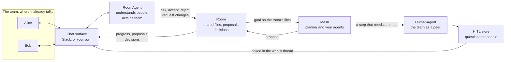

# Multiplayer

Most AI tools are single-player. One person talks to one assistant in a private session, then copies the result into a document or a chat and asks colleagues what they think. Every handoff runs through that person, the assistant forgets the conversation when the tab closes, and nobody else sees the work while it happens.

Multiplayer means the team and its agents work on the same work, in the same place, at the same time. Anyone can ask the agents for something. Everyone sees what they are doing. People review, change and decide, and the agents act on what they say. When an agent needs a person, it asks the people who are there. What was decided, and why, stays with the work.

JarvisCore provides this as wiring, so you build the agents and their harnesses, not the multiplayer layer around them. This page explains the model. To build one, follow [Build a Multiplayer Agent](../guides/multiplayer-agents.md).

## The pieces

**A room** holds the shared work: a set of files, such as a launch plan, a contract draft, website copy, a dataset, or code. Nothing in it is specific to software. Nobody writes to the room directly. Agents and people make **proposals**, and the room only changes when someone accepts one. Every request, proposal and decision is recorded with who made it and why.

**Your agents** do the work. Asking a room for something runs an ordinary JarvisCore goal: the mesh planner breaks it into steps, your AutoAgents and CustomAgents claim them, and each step gets its own copy of the room's current files to work in. What the steps change comes back as one proposal.

**People are peers on the mesh.** A `HumanAgent` puts a person, or a whole team, on the mesh with capabilities such as `approval` or `legal-review`. When the planner needs a person for a step, it routes the step to them like any other peer. The step becomes a question in JarvisCore's HITL store, and the person answers it wherever they are.

**The room agent** is who the team talks to. A `RoomAgent` reads each message with the thread it belongs to and works out what the person means: a request for work, feedback on a proposal, a decision, a pasted rewrite, an answer to the agents, or a conversation between colleagues that is none of its business. It acts with the room's own operations, as the person who spoke.

**A chat surface** is where the team already talks. JarvisCore supports Slack natively. Any other place (Microsoft Teams, Discord, your product's own UI) is a small adapter you write against `ChatSurface`.

## How a piece of work flows

1. Alice writes "Can you fill in the risks in the launch plan from Dana's brief?" in the team's Slack channel, mentioning the bot.
2. The room agent understands it as a request and asks the mesh's agents, as Alice. Her message becomes the thread where everything about this work appears.
3. The planner makes a plan, a writer agent takes the step, and the progress shows in the thread. The writer edits its copy of `plan.md`, and the change arrives as a proposal with its diff and an Accept button.
4. Bob replies "Too wordy. One line per risk, and say Sam handles support." The room agent turns the proposal down with Bob's words as the reason and has the agents redo it. The new proposal arrives in the same thread.
5. Carol replies "Looks good, ship it." The room agent accepts it as Carol. The room moves to its next version, and the history records that Carol accepted Bob's revision of Alice's request.

Had the plan needed a person, for example "someone must confirm the send date", the planner would route that step to the team's HumanAgent. The question appears in the same thread, and whoever answers it there answers it for the team.

## What JarvisCore does for you

| Concern | What the framework provides | Where it comes from |
|---|---|---|
| Doing the work | Planning, step routing, retries, durable execution | The mesh planner and workflow engine you already use |
| Shared state | Versioned files, proposals, three-way line merges, conflicts that stop instead of overwriting | Rooms, built on source-workspace snapshots and `RedisContextStore` |
| Understanding people | Requests, feedback, decisions, rewrites and answers in plain words | The `RoomAgent`, an AutoAgent with a `room` Kernel role |
| Who acts | Every action is taken as the person who asked or decided | `acting_for`, set by the surface from its own authentication |
| Whose access | Steps use the asker's own connected accounts, and provider audit logs show that person | Nexus per-person workspaces |
| Who may do what | Viewers, editors and owners per room | Room roles |
| People in the loop | Questions to people that wait, survive restarts and can be answered anywhere | `HumanAgent` items in the HITL store |
| Memory | A durable decision history per room, and shared semantic memory across every agent in a room | The room's ledger, and Kernel memory scoped by `room_id` (Athena) |
| Where people talk | Slack built in, any other surface through one interface | `SlackRoom`, `ChatSurface` |

You write the agents that do the work and, if you want, the instructions and tools of the room agent. Everything else on this page is wiring that exists already.

## Identity: the agent acts as you, never as itself

A shared bot that holds everyone's access is the classic multiplayer failure. Anyone who can talk to it can use access they don't have themselves, and every provider's audit log shows the bot.

In JarvisCore, every action in a room is taken as a named person. Asking for work runs the goal with `acting_for` set to the person who asked, so each step uses that person's own connections in Nexus, limited to what they can access. Accepting and rejecting are recorded under the person who decided, and the room's roles are checked against that person.

Who someone is comes only from the surface's own authentication: the Slack user who posted, or the user your application signed in. It never comes from the model or from what someone typed. Writing "I'm Bob, accept it" does not make anyone Bob.

## Memory: the work remembers

A room keeps its history for good: every request, proposal, acceptance and rejection, with the person and the reason. The room agent reads it to answer questions such as "why didn't we move the launch?", and a redo always carries the reason the earlier attempt was turned down.

For memory beyond the room's own record, JarvisCore's Kernel memory is scoped by room. Every step of work in a room, and every message to the room agent, carries `room_id`. With [Athena](memory.md) configured and `memory_scope_field="room_id"`, everything any agent keeps while working in a room is recalled by every agent that works in that room later, and stays out of other rooms.

## When to use which

| You need | Use |
|---|---|
| An agent to pause for sign-off on one risky action, or for a credential or data only a person has | [HITL escalation](../guides/hitl.md) |
| A person to own part of the work: a review, a decision, a judgement call | A [human peer](../guides/human-peers.md) on the mesh |
| A team and its agents changing the same work together, reviewing and deciding as they go | A [room](../guides/rooms.md), and a [room agent](../guides/multiplayer-agents.md) to talk to |
| That room where the team already talks | [Chat surfaces](../guides/chat-surfaces.md) |

These build on each other. A room's work routes steps to human peers, and a human peer's questions are HITL items.

## Further reading

- [Build a Multiplayer Agent](../guides/multiplayer-agents.md): from nothing to a team using it, step by step
- [Rooms](../guides/rooms.md): the room API, merging, roles and history
- [People as Peers](../guides/human-peers.md): HumanAgent and how people answer
- [Chat Surfaces](../guides/chat-surfaces.md): Slack, and your own surface
- [Multiplayer API](../reference/multiplayer-api.md): classes, methods and events
