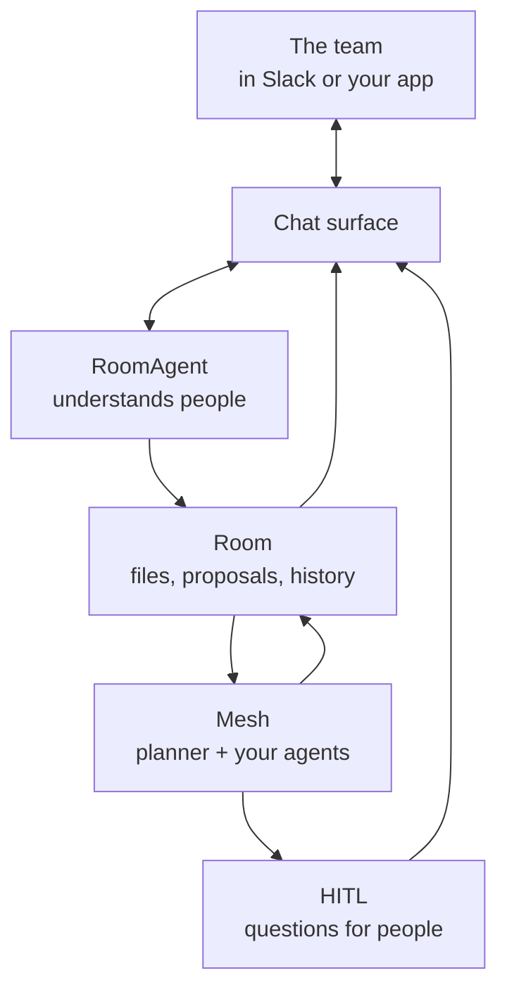
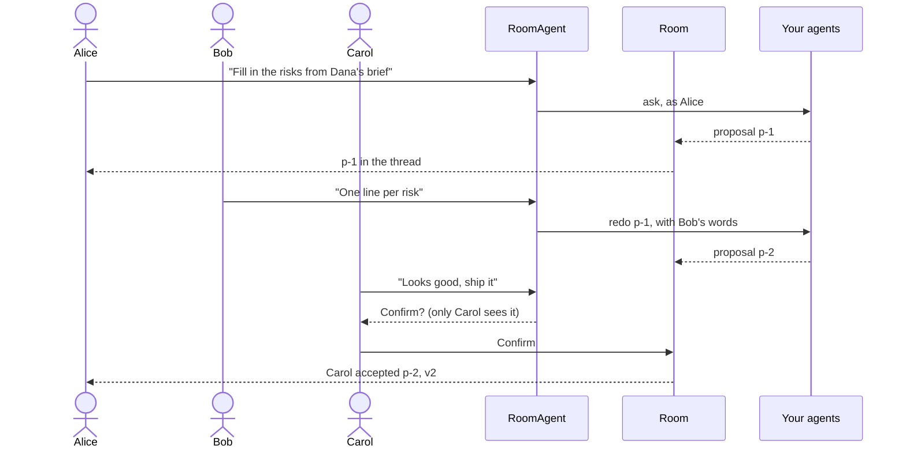
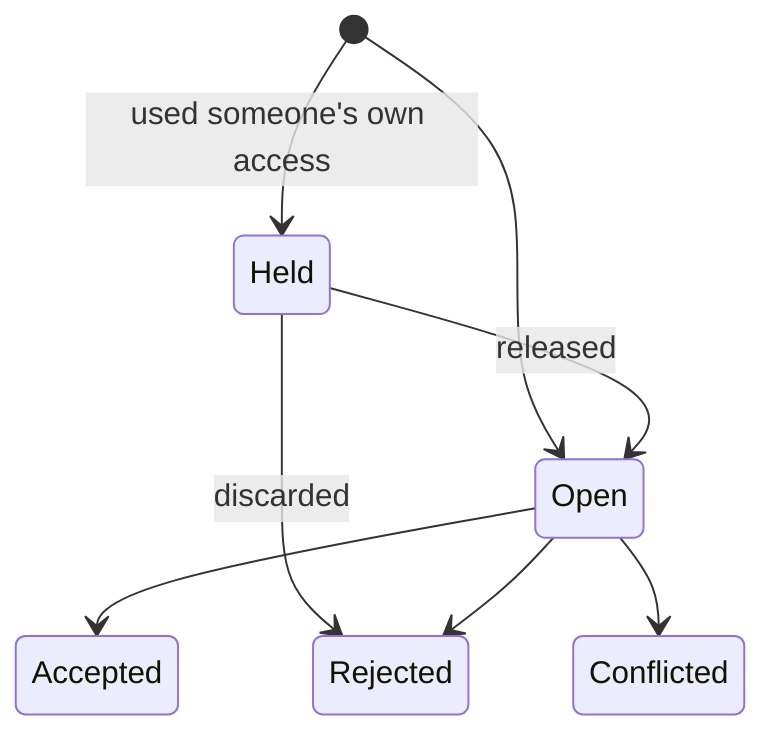

# Multiplayer

Most AI tools are single-player: one person, one assistant, a private session, and the result copied somewhere for colleagues to see. Multiplayer means a team and its agents work on the same work, in the same place. Anyone can ask the agents for something, everyone sees what they do, and people review and decide where they already talk.

You build the agents that do the work. JarvisCore provides the rest: the shared workspace, the agent the team talks to, identity, permissions, people in the loop and delivery to chat. This page explains the model; [Build a Multiplayer Agent](../guides/multiplayer-agents.md) builds one.

## The pieces

| Piece | What it is |
|---|---|
| **Tenant** | A company, team or customer of your product. People, rooms and questions never cross tenants. |
| **Person** | Someone in a tenant, from whatever authenticated them (your app's login, Slack). One human on two surfaces can be linked into one person. |
| **Room** | The shared work: a set of files such as a plan, a contract draft or code. Nobody writes to it directly; it changes only when someone accepts a **proposal**. Private to its members unless the owner opens it. |
| **Your agents** | Asking a room for something runs an ordinary goal. Your AutoAgents and CustomAgents work in their own copy of the files, and what they change comes back as one proposal. |
| **Room agent** | The agent the team talks to (`RoomAgent`). It works out what each message means: a request, feedback, a decision, a pasted rewrite, an answer, or chat that is none of its business. |
| **People in the loop** | When the work needs a person, the question appears in the work's thread and the team answers there ([HITL](../guides/hitl.md), [human peers](../guides/human-peers.md)). |
| **Chat surface** | Where the team already talks. Slack is built in; anything else is a small `ChatSurface` adapter. |

## How a piece of work flows

1. Alice asks the bot to fill in the risks from Dana's brief. The room agent asks your agents, as Alice, and her message becomes the work's thread.
2. A writer agent does it. The thread shows the plan, each step, and the proposal with its diff.
3. Bob replies "One line per risk." The agents redo it with Bob's words; the new proposal replaces the old one once accepted.
4. Carol replies "Looks good, ship it." The room agent prepares the decision and only Carol is asked to confirm. Her tap accepts it, as Carol, and the history records who did what.

## A proposal's life

A proposal is **open** for review, or **held** first when the work used its asker's own access, so only they can release or discard it. Accepting merges it line by line into the current files. When someone changed the same lines in the meantime, it is **conflicted** instead of overwriting their work, and the agents can redo it.

## What makes it safe in a team

A shared agent in a shared channel can fail in ways a personal assistant cannot. JarvisCore enforces these rules on every surface:

- **It acts as the person who spoke.** Identity comes from the surface's authentication, never from what was typed. Work uses that person's own connections in [Nexus](nexus.md).
- **Roles hold everywhere.** Viewers, editors and owners are checked on every tool, button and API call.
- **The agent never decides.** Accepting, rejecting, releasing, stopping work and signing off are prepared by the agent and confirmed with one tap by the person deciding.
- **Private access stays private.** Work that used someone's own mail, drive or CRM is held for them. Owners name the systems the whole room may see.
- **A room is shown only where everyone may see it.** In Slack, a private room needs a private channel whose members are all in the room. If that stops being true, the room pauses there and says why.
- **Nothing is lost or done twice.** Messages are recorded before they are acknowledged and handled once, in order. Decisions are made once. Work belongs to the mesh, so if one process stops, another finishes it.
- **Removing someone ends everything they could do**, at once.

## The team's record and memory

Every request, proposal and decision is kept with who made it and why. The room agent answers "why didn't we move the launch?" from it, and `room.audit()` adds whose access each piece of work used and what it cost. Spending is charged to the person each piece of work is for, with optional caps.

The room also remembers what was said and what its agents kept: in [Athena](memory.md) when configured, otherwise in the local store on that machine. Every agent in the room shares that memory; what came from one person's own access stays private to them. See [Memory in a room](memory.md#memory-in-a-room).

## When to use which

| You need | Use |
|---|---|
| An agent to pause for sign-off on one risky action, or for data only a person has | [HITL escalation](../guides/hitl.md) |
| A person to own part of the work: a review, a decision, a judgement call | A [human peer](../guides/human-peers.md) on the mesh |
| A team and its agents changing the same work together | A [room](../guides/rooms.md), and a [room agent](../guides/multiplayer-agents.md) to talk to |
| That room where the team already talks | [Chat surfaces](../guides/chat-surfaces.md) |

These build on each other. A room's work routes steps to human peers and asks for sign-off through HITL, and both reach the team in the room's chat.

## Further reading

- [Build a Multiplayer Agent](../guides/multiplayer-agents.md): from nothing to a team using it, step by step
- [Rooms](../guides/rooms.md): the room API, people and roles, private access, merging and history
- [Chat Surfaces](../guides/chat-surfaces.md): Slack, and your own product
- [People as Peers](../guides/human-peers.md): people the planner routes work to, and how they answer
- [Multiplayer API](../reference/multiplayer-api.md): classes, methods and events
