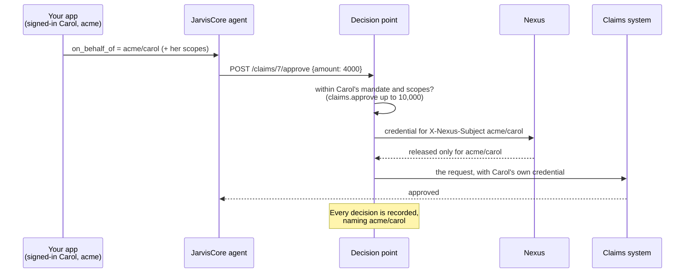
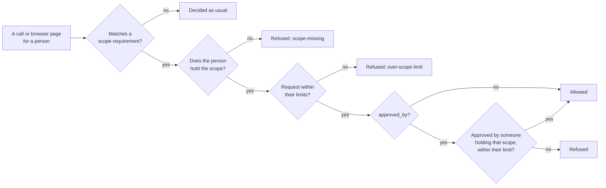

# Agents That Act for Your Users

Your application already knows who its users are: it signs them in, and it may
have tenants, roles and an admin console. This guide connects that to
JarvisCore, so that an agent working for one of your users:

- uses **that user's own accounts** (their Salesforce, their Gmail), never
  another user's and never a shared service account;
- does **only what they may do in your organisation** (your scopes: approve
  claims up to their limit, read financial reports) and **only what they
  delegated** for this work;
- leaves a record that **names them**, which you can hand to their auditor.

You keep user management. JarvisCore never authenticates your users; it acts for
whoever your application says the work is for.



---

## Which case are you?

| You are building | What you need |
|---|---|
| An internal tool, a script, one team | Nothing on this page. Work runs as the deployment's own identity (`NEXUS_DEFAULT_USER_ID`, default `jarviscore-agent`). |
| A product with signed-in users, each connecting their own accounts | [Name whom the work is for](#1-name-whom-the-work-is-for), [connect their accounts](#2-connect-each-users-accounts), [turn on subject binding](#3-make-nexus-hold-you-to-it) |
| A multi-tenant SaaS | All of the above with tenant-qualified people (`OnBehalfOf.of(tenant, user)`), plus [per-tenant evidence](#7-evidence-per-user-and-per-tenant) |
| Teams where only some people may do some things (approve claims, read financial reports, file a SAR) | Also [your organisation's scopes](#4-hold-them-to-your-organisations-scopes) |
| Agents your users' admins configure | Also [mandates from your roles](#5-limit-what-they-delegated-for-this-work) and [approvals from your sign-in](#6-approvals-from-your-sign-in) |

---

## 1. Name whom the work is for

Every entry point takes `on_behalf_of`:

```python
from jarviscore import Mesh, OnBehalfOf

user = OnBehalfOf.of(session.tenant_id, session.user_id)   # "acme/u_123"

await mesh.run_task(agent="analyst", task="Summarise my open deals", on_behalf_of=user)
await mesh.execute_goal("Reconcile last month's invoices", on_behalf_of=user)
await mesh.workflow("wf-42", steps, on_behalf_of=user)
workflow_id = await mesh.submit_goal("Prepare the board pack", on_behalf_of=user)
```

`on_behalf_of` takes an `OnBehalfOf`, a `Person` or a person key. It decides
whose credentials the work uses, what it may do (their
[scopes](#4-hold-them-to-your-organisations-scopes) and
[mandate](#5-limit-what-they-delegated-for-this-work)), and whom every record
names. It covers every step and sub-agent, and for a workflow (`execute_goal`,
`submit_goal`, `workflow`) every node that runs one of its steps.

!!! warning "Always qualify by tenant"
    `OnBehalfOf.of("acme", "u_123")` is `acme/u_123`. Credentials, Nexus
    workspaces and records are keyed by this string, so two tenants that both
    have a user `u_123` must never share it. A tenant or user id containing `/`,
    `{` or `}` is refused.

Whom work is for comes only from your code, never from a client or an agent.
For a block of your own code, use `act_for`:

```python
from jarviscore import act_for

with act_for(user):
    await my_custom_pipeline()     # every provider call in here is for that user
```

### From a chat endpoint

`create_chat_router` asks your application whom each chat is for:

```python
from fastapi import HTTPException, Request
from jarviscore import OnBehalfOf
from jarviscore.integrations import create_chat_router

async def signed_in_user(request: Request) -> OnBehalfOf:
    session = await my_auth.session(request)          # your sign-in, your tenants
    if session is None:
        raise HTTPException(status_code=401)
    return OnBehalfOf.of(session.tenant_id, session.user_id, mandate=session.mandate)

app.include_router(create_chat_router(kernel, on_behalf_of=signed_in_user), prefix="/api/v1")
```

The resolver may be sync or async; raise `HTTPException` to refuse, or return
`None` for the deployment's own identity. A client can never name someone else
(`acting_for`, `mandate` and `scopes` in the body are dropped), and each
conversation belongs to whoever started it: nobody else can continue, stream or
read it (403).

---

## 2. Connect each user's accounts

A user connects an account once (OAuth consent through
[Nexus](nexus.md)), and work done for them finds it from then on, on any node:

```python
@app.post("/integrations/{provider}/connect")
async def connect(provider: str, request: Request):
    user = await signed_in_user(request)
    if await mesh.connected(provider, on_behalf_of=user):
        return {"connected": True}
    started = await mesh.connect(provider, on_behalf_of=user,
                                 return_url="https://app.example.com/integrations/done")
    return {"connected": False, "auth_url": started["auth_url"]}   # send the browser here
```

Each user's connection lives in their own Nexus workspace. If work needs an
account they have not connected, the agent pauses and asks for consent through
your [HITL surface](hitl.md). `connect` needs a Nexus gateway
(`NEXUS_GATEWAY_URL`); `provider_scopes=` is the provider's OAuth scopes, not
your organisation's scopes below.

---

## 3. Make Nexus hold you to it

JarvisCore names the person on every credential request (`X-Nexus-Subject`, with
the agent and the operation). Set the broker to refuse anything else:

```bash
SUBJECT_BINDING=required          # on your nexus-broker
NEXUS_SUBJECT_BINDING=required    # or, for the local stack: jarviscore nexus up
```

Then a credential is released only to work for the person who owns it. A
refusal is never replaced by some other credential, and Nexus audits every
release and refusal. Nexus trusts the subject your runtime names, so keep the
gateway key with the runtime and authenticate users in your application.

---

## 4. Hold them to your organisation's scopes

A provider's own scopes (`read`, `write`) say what a credential can reach. They
cannot say that only Carol may approve claims, and only up to 10,000; that
suspicious-activity reports go only to the MLRO; that only finance opens
financial reports. Those are **your organisation's scopes**, you define them, and
an agent working for a person holds exactly that person's.

**Your application says what each person holds**, from its own roles or identity
provider:

```python
carol = OnBehalfOf.of("acme", "carol", scopes={
    "claims.vet": {},
    "claims.approve": {"amount": "10000"},             # a level: up to 10,000
    "fincrime.sar.send": {"recipients": ["mlro@acme.com"]},
})
await mesh.execute_goal("Settle the claims in today's queue", on_behalf_of=carol)
```

**Your policy file says which operations need which scope**, and the limits:

```yaml title="control-policy.yaml"
scopes:
  require:
    - name: claim-approval
      match: {provider: guidewire, method: POST, path: "/claims/{id}/approve"}
      requires: claims.approve
      limits:
        - {field: json.amount, kind: money, at_most: amount}
    - name: sar-recipients
      match: {provider: casework, method: POST, path: "/sars/{id}/send"}
      requires: fincrime.sar.send
      limits:
        - {field: json.to, kind: email, one_of: recipients}
    - name: financial-reports
      match: {provider: erp, method: GET, path: "/reports/financial/{id}"}
      requires: finance.reports.read
    - name: finance-portal                   # the same, in a browser
      match: {sink: browser, target: "finance.acme.com/*"}
      requires: finance.reports.read
```

Then, for work done for Carol: a 4,000 claim is approved; a 40,000 claim is
refused (`over-scope-limit`); a SAR to anyone but the MLRO is refused. For Dave,
who holds only `claims.vet`, approving any claim is refused (`scope-missing`).



**The answer is no, every time:**

- **In every mode but `off`**, report mode included. No deployment rule lifts it.
- **Whatever code tries**, when you match the operation (`method` and `path`):
  an integration, model-written code or your own client. (`atom:` alone holds
  only that integration; `jarviscore policy scopes` flags it.)
- **Fail closed.** A limit the grant does not state is refused (`"*"` means no
  limit), and so is a value the request does not carry.
- **On what actually leaves**, typed (money as decimals). Add a
  [grounding rule](../concepts/control-and-evidence.md#grounding) so the amount
  must also be the claims system's own figure, not one the agent chose.

**Doing and authorising are different scopes.** `approved_by` requires that
whoever approves holds a scope, within its limits for this exact request:

```yaml
    - name: claim-payment
      match: {provider: guidewire, method: POST, path: "/claims/{id}/payments"}
      requires: claims.pay              # the person the agent works for
      approved_by: claims.approve       # whoever approves it
      limits:
        - {field: json.amount, kind: money, at_most: amount}
```

The action then always waits for an approval, and only someone known to hold
the scope may give it ([section 6](#6-approvals-from-your-sign-in)); their limit
is checked when it runs.

**People without your sign-in** (rooms, people peers) take their scopes from the
policy file; your application's grant comes first for any scope it names:

```yaml
scopes:
  grants:
    acme/carol: {claims.approve: {amount: "10000"}}
  unattended: {}       # what work done for no one holds
```

The agent sees what is out of reach as refused, so it tells the person plainly
instead of trying something else. Every decision records the scopes it was
checked against, and `jarviscore policy scopes` prints who may do what. Every
key and rule is in the [Control Policy Reference](../reference/control-policy.md#scopes-what-each-person-may-do-in-your-organisation).

---

## 5. Limit what they delegated for this work

A user's credential and scopes already limit the agent to what that user may do.
A **mandate** narrows it to what they handed over for this piece of work: which
systems, which effects, which of their scopes, until when.

```python
user = OnBehalfOf.of(tenant, user_id, mandate={
    "systems": ["salesforce", "gmail"],
    "effects": ["read", "propose"],          # read, propose, write, notify, destructive
    "scopes": ["claims.vet"],                # of their scopes, these only
    "expires_at": "2026-11-01T00:00:00Z",
})
```

A provider call outside it is refused (`outside-mandate`), in every mode but
`off`. Mandates hold provider calls; for browser pages, use scopes.

---

## 6. Approvals from your sign-in

When an action needs a person's approval, your backend signs the approval after
your own sign-in, over the exact action. JarvisCore checks the signature and
your institution's approval rules:

```python
from jarviscore.control.approvals import sign_assertion

approver = OnBehalfOf.of(session.tenant_id, session.user_id)
w = result["waiting"]["metadata"]       # from execute_goal / run_task: workflow_id, action_id, binding
token = sign_assertion(APPROVAL_ASSERTION_KEY, subject=approver.person, roles=session.roles,
                       scopes=session.scopes,          # for approved_by scopes
                       decision="approved", workflow_id=w["workflow_id"],
                       action_id=w["action_id"], binding=w["binding"])
await mesh.resolve_hitl(w["workflow_id"], w["action_id"], decision="approved", assertion=token)
```

Use the approver's person key as `subject`, so maker-checker can tell when the
approver is the person who asked. Pass their `scopes` where an `approved_by`
scope applies. See [HITL](hitl.md#approving-an-agents-consequential-actions).

---

## 7. Evidence per user and per tenant

Everything an agent did for a user is in the journal under their name. Ask for
one user, or a whole tenant (a key ending in `/`):

```bash
jarviscore evidence acme/u_123
jarviscore evidence acme/
```

```text
2026-10-25T21:27:36.817144+00:00  wf-42/pay  agent=ledger  for=acme/u_123  outcome=failure
    2026-10-25T21:27:36.817696+00:00  allowed      provider  GET      erp.example/invoices/7  [within-policy]
    2026-10-25T21:27:36.817813+00:00  refused      provider  POST     erp.example/payments  [over-scope-limit]  scopes: payments
        json.amount is beyond what acme/u_123 may do under payments.make (amount is the limit).

1 run(s), 2 decision(s), 1 effect(s), 1 refused.
```

To hand a tenant's record to their auditor:

```bash
jarviscore evidence acme/ --export acme-evidence/
jarviscore verify --export acme-evidence/        # what the auditor runs; no keys, no network
```

The export holds the tenant's runs exactly as written, with nothing about anyone
else's; runs shared with others are left out and listed. The auditor can check
each run is intact, but not that none was left out (that needs the whole
journal). `--content` adds what replay needs, which is personal data. From Python:
`jarviscore.evidence.people.account`, `export` and `erase`.

### Erasure

```bash
jarviscore evidence acme/u_123 --erase           # what would go
jarviscore evidence acme/u_123 --erase --yes     # erase it
```

This erases the replay content (tasks, model calls, tool results) of runs done
only for that user. The journal keeps only digests of it, so it still verifies
and still records every decision; those runs just cannot be replayed. Content
unused for `JOURNAL_CONTENT_DAYS` (30) is erased anyway.

---

## Checklist

- [ ] Every entry point your users reach passes `on_behalf_of`, built from your sign-in, never from request data.
- [ ] People are tenant-qualified: `OnBehalfOf.of(tenant, user)`.
- [ ] `create_chat_router(..., on_behalf_of=...)` if you expose chat.
- [ ] Each user connects their own accounts (`mesh.connect`); no shared service credentials for user work.
- [ ] Nexus broker runs with `SUBJECT_BINDING=required`.
- [ ] What only some people may do is a scope: required in `scopes.require` (matched on the operation), granted on `OnBehalfOf(..., scopes=...)` from your roles.
- [ ] `jarviscore policy check` and `jarviscore policy scopes` read your policy as you meant it.
- [ ] Mandates come from your roles.
- [ ] Approvals are signed by your backend (`APPROVAL_ASSERTION_KEY`), with the approver's scopes where `approved_by` asks for them.
- [ ] You know how to answer "what did the agent do for us?" (`jarviscore evidence acme/ --export`).
