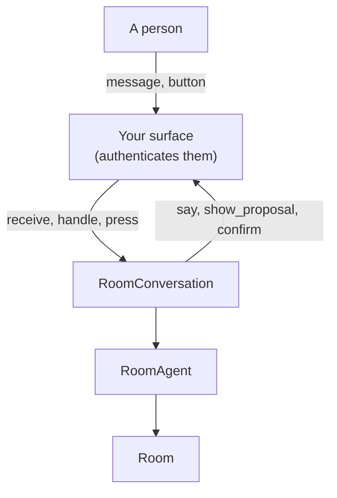

# Chat Surfaces

A room's conversation happens where the team already talks: Slack, your product's own pages, Microsoft Teams, Discord. JarvisCore splits this in two:

- **`RoomConversation`** does everything multiplayer: it records messages, hands them to the room agent as the person who sent them, posts the work in the right thread, asks people to confirm decisions, keeps held work private, asks the agents' questions, and checks who can see the surface before posting.
- **A `ChatSurface`** only moves messages to and from one place. JarvisCore ships `SlackApp` for Slack; for anything else you write one class.



[Build a Multiplayer Agent](multiplayer-agents.md) walks through both with a running example. This page is the reference for building a surface.

## What a surface implements

```python
from jarviscore.room import ChatSurface


class MySurface(ChatSurface):
    key = "web:launch"           # unique per place a room is shown; keys the saved state

    async def say(self, thread, text, *, detail="", code="", to=None) -> str: ...
    async def show_proposal(self, thread, text, diff, proposal_id, *, to=None, held=False) -> str: ...
    async def confirm(self, thread, decision, *, to) -> str: ...

    # Optional:
    async def notice(self, thread, text, *, to) -> str: ...          # default: say(..., to=to)
    async def audience(self, room) -> str | None: ...               # default: None (may show it)
    async def history(self, thread) -> list[dict]: ...              # default: []
```

| Method | Called to | Your surface |
|---|---|---|
| `say` | post a line of the room's work, the agent's reply, or a question from the agents | posts `text` in `thread` (None for the top level), with `detail` as quoted context and `code` verbatim. With `to`, shows it to that person only, durably |
| `show_proposal` | show a proposal | posts `text` and the `diff` with **Accept** and **Full change** buttons; when `held`, shown `to` the person it is held for, with **Release** and **Discard** |
| `confirm` | ask one person to confirm a decision the agent prepared | shows `decision["summary"]` to `to` alone, with **Confirm** and **Cancel**, whose target is `decision["id"]` |
| `notice` | tell one person something brief (a refusal, "Cancelled.") | may be transient, like a Slack message only they see |
| `audience` | check, before posting, that everyone who can see this place may see the room | returns why not, or None |
| `history` | give the agent the thread's earlier messages it never received | returns `{"person", "text"}` |

Every posting method returns your id for what it posted. A thread is your id of the message a conversation hangs off: the first message of a piece of work becomes its thread.

The button names are constants in `jarviscore.room`: `ACCEPT`, `SHOW_CHANGE`, `RELEASE`, `DISCARD`, `CONFIRM`, `CANCEL`. When someone presses one, call `press` with the person, the button and its target.

## Driving the conversation

```python
conversation = RoomConversation(room, agent, MySurface())
await conversation.start()                     # resume saved state and unfinished work
asyncio.create_task(conversation.follow())     # post the room's progress until cancelled

# For each message, with the person from your own authentication:
if conversation.receive(person, text, message_id=id, thread=thread_id, addressed=to_the_agent):
    asyncio.create_task(conversation.handle(id))

# For each button press:
await conversation.press(person, action, target, thread_id)
```

| Call | What it guarantees |
|---|---|
| `receive` | Records the message once, durably. Call it before you acknowledge the message: once it returns, the message is handled even if the process stops. A redelivery returns False |
| `handle` | Handles a received message once, in order within its thread, across every process |
| `hear` | `receive` and `handle` together |
| `press` | Carries out a button for the person who pressed it, with their room role; a confirmation only for the person it was meant for, once, before it expires (10 minutes) |
| `start` | Picks up the saved threads, any message received but not handled, and work started before a restart |
| `follow` | Posts each update, holding a lease so one process posts at a time; the place in the feed is saved only after each post succeeds, so a failure retries instead of skipping. An update is posted once, unless the process stops in the instant between the surface accepting it and it being recorded: then that one update is posted again |

`addressed` says the person spoke to the agent (an @-mention, an "ask the agents" box). Replies in threads the room started reach the agent without it; anything else does not, so colleagues can talk in the same place.

## Who sees what

A surface that is a shared space, such as a channel, shows everything to everyone in it. So before posting anything, `RoomConversation` asks the surface's `audience`. If it returns a reason, the room stops posting there and says why, once, and the room agent does not work there. It checks again regularly, at once when the room's members or visibility change, and when you call `recheck_audience()` (call it when someone joins or leaves your space). When the reason goes away, it says so and catches up.

A surface that shows each person their own view, like a web page that checks the signed-in user, keeps the default: it filters per person instead, using `to` and `conversation.can_see(person, item)`.

Held work and confirmations are always addressed with `to`: show them to that person only.

## Slack

`SlackApp` is the Slack surface, with Slack reached through Nexus and events over Socket Mode (no public URL). One `SlackApp` serves every room of a tenant in its workspace, each room in its own channel:

```python
from jarviscore.room.slack import SlackApp

slack = SlackApp(agent, tenant="acme")
slack.connect(launch_room, "C0LAUNCH")
slack.connect(hiring_room, "C0HIRING")
await slack.run()
```

Set up the Slack app and its tokens as in [Build a Multiplayer Agent: in Slack](multiplayer-agents.md#step-5-in-slack). Run `SlackApp` in as many processes as you like: Slack shares events between their connections, and each message is handled once and each update posted once.

| | In Slack |
|---|---|
| A person | A full member of the workspace the app is installed in, resolved through `Identities` (first message makes them a person). Guests, people from other organisations and bots are refused. `identify=` maps Slack users to your own people instead |
| A message for the room | A mention of the bot in the room's channel, or any reply in a thread the room started |
| Receiving | Recorded before Socket Mode is acknowledged; if recording fails, Slack sends it again |
| Proposals | A threaded message with the diff and **Accept** and **Full change** buttons |
| Held work | A direct message to the asker with **Release** and **Discard** (a message only they see in the thread, if the app has no `im:write`); the channel sees a line saying it is waiting for them |
| Confirmations and refusals | Messages only that person sees |
| Who may see it | A private room needs a private channel; every member of the channel must be able to see the room; no room is shown in a channel shared with another organisation. Joining and leaving the channel is noticed at once |

## Testing a surface

`jarviscore.testing.rooms.MemorySurface` records everything a conversation posts, including what was shown to one person (`to`) and the confirmations it asked for, and lets you set `audience_problem` or make posts fail (`fail_next`). `ScriptedRoomAgent` runs the real room tools from scripts instead of a model. `jarviscore.testing.slack.FakeSlack` speaks Slack's Web API and Socket Mode on a local port, with Slack's behaviour where correctness depends on it. See [Build a Multiplayer Agent: test it](multiplayer-agents.md#step-7-test-it-without-a-model-or-a-workspace).

## Further reading

- [Build a Multiplayer Agent](multiplayer-agents.md): a surface in your product and in Slack, step by step
- [Rooms](rooms.md): what the conversation acts on
- [Multiplayer API](../reference/multiplayer-api.md): every class and method
