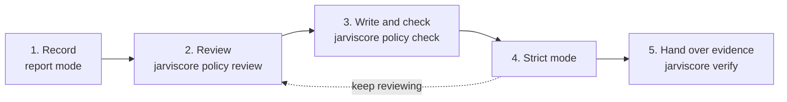

# Turning On Control

Out of the box, JarvisCore **decides on and records** everything your agents do
outside their steps: every call to a provider, every program they run, every
file, memory, message, browser request and result. Nothing is refused until you
say so. This guide takes a deployment from that default to **strict mode**, where
what your policy does not allow does not happen, in five steps.



How it works is in [Control and Evidence](../concepts/control-and-evidence.md);
every key of the policy file is in the [Control Policy Reference](../reference/control-policy.md).
If your agents work for your application's users, what each of them may do
(their scopes, and what they delegate for a piece of work) is in
[Agents That Act for Your Users](acting-for-your-users.md); those refusals hold in
report mode too.

---

## 1. Record what your agents do

The defaults already do this:

```bash
CONTROL_MODE=report                 # decide and record; refuse only what a person may not do
JOURNAL_DIR=.jarviscore/journal     # where the record is kept
```

Run your workflows as usual. Each workflow step gets a hash-linked record of its
decisions and effects. Check that it is intact at any time:

```bash
jarviscore verify
```

## 2. See what strict mode would refuse

```bash
jarviscore policy review
```

```text
   12 x would refuse             browser-send-off-site      browser send api.shop.example/graphql
        If the site really sends there, allow the host: effects: allow {sink: browser, target: "<host>/*"}.
    3 x would refuse             unconfined-execution       code run program
        Run where the sandbox is confined (macOS sandbox-exec, Linux bubblewrap), or accept the risk: effects: allow {sink: code}.
```

Each line is a decision strict mode would make differently, with how often it
happened and what to do about it. Some are your policy to write (a host your app
really sends to); some are the runtime telling you something you should fix (an
integration that does more than it declares).

## 3. Write your policy, and check it

One YAML or JSON file, named by `CONTROL_POLICY_PATH`. Start from what the
review showed and what your institution requires:

```yaml
# control-policy.yaml
effects:
  - name: shop-api                      # our storefront's own API
    decision: allow
    match: {sink: browser, target: "api.shop.example/*"}
  - name: no-result-broadcast           # keep step results off the P2P network
    decision: deny
    match: {sink: peer, action: broadcast}

approvals:
  - name: payments-need-finance
    match: {effect: [write, destructive], provider: erp}
    roles: [finance]
    distinct_from: [requester]          # not the person who asked
    assurance: verified                 # signed by your backend

grounding:
  - name: pay-the-supplier-on-record
    match: {provider: erp, method: POST, path: /payments}
    bind:
      - name: invoice
        read: {provider: erp, path: "/invoices/{id}"}
        where: {id: request.json.invoice}
      - name: supplier
        read: {provider: erp, path: "/suppliers/{id}"}
        where: {id: invoice.supplier_id}
    require:
      - {field: request.json.iban, equals: supplier.iban, as: iban}
      - {field: request.json.amount, at_most: invoice.amount_due, as: money}
    other_fields: deny
```

A rule the runtime cannot read fails closed: it refuses what it matches, or
everything. That is safe and hard to debug, so check the file before deploying
it, and in CI:

```bash
jarviscore policy check control-policy.yaml
```

```text
control-policy.yaml: 0 rules, 1 approvals, 0 principals, 1 grounding, 2 effects, 0 scopes

Mode: report. Sandbox confinement: available.
Every rule reads as written.
```

It exits 1 on any problem and names it: an unknown section, a match key a rule
can never meet, a grounding requirement that refers to nothing bound.

## 4. Switch to strict

```bash
CONTROL_MODE=strict
CONTROL_POLICY_PATH=control-policy.yaml
```

Strict mode needs two things from the host:

- **A confined sandbox** for code the model writes: macOS `sandbox-exec`, or Linux
  bubblewrap where unprivileged user namespaces are allowed. Without one, that
  code would reach the network and the host directly, so strict mode refuses it
  (`unconfined-execution`). `jarviscore policy check` says whether this host has
  it. If you must run unconfined, say so: `effects: allow {sink: code}`.
- **A writable journal.** In strict mode an effect whose decision cannot be
  recorded does not happen. (With `JOURNAL_DIR=off` there is nothing to record
  to, and decisions go unrecorded.)

Keep running `jarviscore policy review`: in strict mode it lists what *was*
refused, and what was refused before anyone was asked to approve it.

## 5. Hand over the evidence

The journal checks offline, with no keys and no network, so you can give a copy
to an auditor:

```bash
jarviscore verify /path/to/journal-copy --json
```

It checks every run's hash chain and its head in the head log, that every effect
followed an allow decision, that every call carrying an approval had an approval
of that exact action, and that every grounded call cites reads that are in the
record. The exact claims and the tests behind them are in
[`claims/`](https://github.com/Prescott-Data/jarviscore-framework/tree/main/claims).

---

## What your agents see

Refusals reach the agent as tool results it can reason about, and your code as
exceptions it can catch.

| Result | Meaning |
|---|---|
| `WAITING_FOR_APPROVAL` | A person must approve this exact action; the step pauses at no cost |
| `POLICY_WOULD_REFUSE` | The action was previewed and policy would refuse it, so nobody was asked |
| `POLICY_REFUSED` | A message, memory or result policy refused |
| `error_type: PolicyDenied` | Sandboxed code or a provider call policy refused |
| `ATOM_PARAMETERS_INVALID` | An integration was called without what it needs |
| `EFFECT_INTENT_UNRESOLVED` | The same action was held back twice for missing evidence; the agent reports what is missing |
| `OUTCOME_UNKNOWN` | A run stopped while carrying an approved action out; a person reconciles it |
| `SCOPE_MISSING` | The person the work is for may not use this integration (it was offered as refused); nothing ran |

| Exception | Raised by |
|---|---|
| `jarviscore.control.policy.PolicyDenied` | A provider call refused: by strict mode, or in any mode beyond what the person may do |
| `jarviscore.control.effects.EffectDenied` | Any other effect refused, likewise |
| `jarviscore.control.approvals.ApprovalRefused` | An approval that does not meet policy (`Mesh.resolve_hitl`) |

## Your own effects

A `CustomAgent` or a tool you write that acts on the world (sends an email
through your SMTP server, writes to your database) can be decided on and recorded
the same way:

```python
from jarviscore.control.effects import Effect, EffectDenied, content_digest, mediated

async def send_receipt(to: str, body: str) -> dict:
    try:
        with mediated(Effect("peer", "send", target=to, origin="model",
                             attributes=content_digest(body))) as effect:
            await smtp.send(to, body)
            effect.done(ok=True)
    except EffectDenied as refused:
        return {"status": "error", "error": str(refused)}
    return {"status": "sent"}
```

It is decided under the same `effects:` rules, recorded in the same journal, and
checked by the same `jarviscore verify`.

## Testing with a policy

Point a test at its own policy and journal; nothing else changes:

```python
@pytest.fixture
def strict(monkeypatch, tmp_path):
    from jarviscore.control import policy

    path = tmp_path / "policy.yaml"
    path.write_text("effects:\n  - {name: test-host, decision: allow, match: {sink: code}}\n")
    monkeypatch.setenv("JARVISCORE_CONTROL_MODE", "strict")
    monkeypatch.setenv("JARVISCORE_CONTROL_POLICY", str(path))
    monkeypatch.setenv("JARVISCORE_JOURNAL_DIR", str(tmp_path / "journal"))
    monkeypatch.setattr(policy, "_cached", None)
    return tmp_path / "journal"
```

Test runners often cannot confine the sandbox (the installed package may sit
outside what the sandbox can read), hence the `{sink: code}` allowance above.
After the test, `jarviscore.evidence.journal.verify(str(journal))` checks what
it did.
