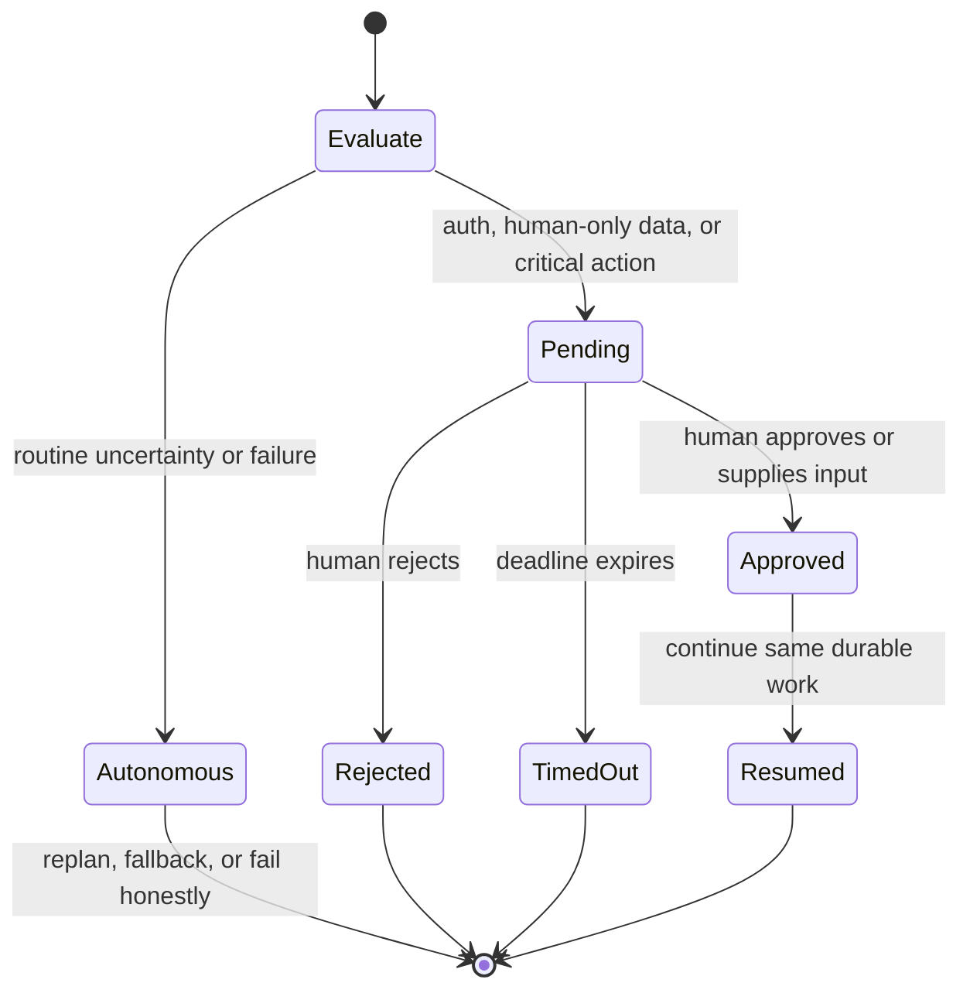

# Human-in-the-Loop (HITL) Escalation

JarvisCore agents are designed to operate autonomously. The Human-in-the-Loop (HITL) system exists for the narrow set of situations where a human decision is genuinely required: not for quality checks or uncertainty the agent should resolve itself.

This guide covers when to escalate, the complete `HITLQueue` API, how resolutions are delivered back to the agent, and how to wire up a review dashboard.

---

## When to Escalate (and When Not To)

The HITL system enforces a strict **category gate**. Every escalation request must declare one of three permitted categories. Passing any other category raises `ValueError` at call time, forcing the agent to reconsider before the item reaches a human reviewer.

| Category | When to use |
|---|---|
| `auth_required` | A Nexus credential is missing, expired, or has insufficient scope. The agent cannot proceed without a human supplying or re-authorising a credential. |
| `data_required` | A piece of data that only a person can supply is missing (e.g., a client's bank details, an unpublished contract, internal pricing). |
| `critical_action` | The next action is irreversible or high-consequence (e.g., sending a bulk email campaign, triggering a payment, deploying to production). |

**Do not escalate for:**

- Output quality doubts ("the summary seemed too short")
- Self-validation ("is this analysis correct?")
- General uncertainty where the agent can take a safe fallback action
- Routine content review

Agents must handle those cases autonomously. The HITL queue is for decisions only a person can make, not for the agent's confidence management.

### Who responds

An escalation goes to whoever your deployment makes responsible for it: an on-call engineer for an expired credential, a finance approver for a payment, the account owner for a client's data. JarvisCore does not assume who that is. Each request carries `targets`, the people or roles that should respond, and your review surface (a dashboard, a Slack channel, a ticket queue) uses them to put the item in front of the right person.

Set the default for a deployment with `HITL_TARGETS` (comma-separated, default `reviewer`) or `Mesh(config={"hitl_targets": [...]})`, and name someone for a single request with `targets=`:

```python
self.hitl.request(
    title="Approve the €40,000 supplier payment",
    content="Invoice INV-2291 from Northwind, due Friday.",
    category="critical_action",
    targets=["finance-approver"],
)
```

HITL is a gate on one agent's action. When a person should do part of the work itself, such as reviewing a draft, deciding between options, or editing a file, put them on the mesh as a [human peer](human-peers.md) instead, or let the whole team work on it together in a [room](rooms.md).



---

## Accessing the Queue

`self.hitl` is injected into every agent by the Mesh at `start()` time. You do not instantiate `HITLQueue` directly.

```python
class MyAgent(AutoAgent):
    async def execute_task(self, task: str, context: dict = None) -> dict:
        # The hitl attribute is always available
        item_id = self.hitl.request(
            title="Approve investor deck before sending",
            content="The deck is ready for Q2 investor distribution. Approve to proceed.",
            urgency="high",
            category="critical_action",
            context={"file": "output/q2_deck.pdf", "recipients": 47},
        )
        ...
```

---

## HITLQueue API

### request

Submits a new review item to the human inbox. Returns a `request_id` string you use to poll for the decision.

```python
item_id = self.hitl.request(
    title="GitHub OAuth token expired for user 'alice'",
    content="The researcher agent attempted to read private repos for user 'alice' "
            "but the OAuth token has expired. Re-authorise via the Nexus dashboard.",
    urgency="high",
    category="auth_required",
    context={
        "workflow_id": context.get("workflow_id"),
        "step_id": "fetch_repos",
        "provider": "github",
        "user_id": "alice",
    },
)
```

| Parameter | Type | Required | Description |
|---|---|---|---|
| `title` | `str` | Yes | Headline shown in the review list. Never truncated: keep it descriptive. |
| `content` | `str` | Yes | Full details for the reviewer. Markdown is supported. Truncated to 2,000 characters. |
| `urgency` | `str` | No | One of `"low"`, `"normal"`, `"high"`, `"critical"`. Default: `"normal"`. |
| `category` | `str` | Yes | One of `"auth_required"`, `"data_required"`, `"critical_action"`. Any other value raises `ValueError`. |
| `context` | `dict` | No | Structured metadata. String values are truncated to 1,000 characters. |
| `targets` | `list[str]` | No | Who should respond, e.g. `["finance-approver"]`. Default: the deployment's `hitl_targets`. |

Raises `ValueError` if `urgency` or `category` is invalid.

---

### check

Non-blocking poll. Returns `HITLResolution` if the item has been decided, `None` if still pending.

```python
resolution = self.hitl.check(item_id)
if resolution is not None:
    if resolution.is_approved:
        await self._proceed()
    else:
        logger.warning("Action rejected: %s", resolution.note)
```

The resolution is checked against the flat JSON file first (always available), then against Redis if configured.

---

### wait

Async-polling version of `check`. Suspends the calling coroutine until a decision arrives or the timeout expires. The event loop remains active during the wait.

```python
try:
    resolution = await self.hitl.wait(item_id, timeout=3600, poll_interval=10)
    if resolution.is_approved:
        await self._send_email_campaign()
    else:
        return {"status": "cancelled", "reason": resolution.note}
except TimeoutError:
    return {"status": "timeout", "message": "No decision received within 1 hour."}
```

| Parameter | Type | Default | Description |
|---|---|---|---|
| `request_id` | `str` | Required | ID returned from `request()` |
| `timeout` | `float` | `3600.0` | Maximum seconds to wait before raising `TimeoutError` |
| `poll_interval` | `float` | `10.0` | Seconds between each check |

---

### pending

Returns all pending HITL items submitted by the calling agent. Useful before submitting a new request to avoid duplicates.

```python
pending = self.hitl.pending()
already_waiting = any(p["title"].startswith("GitHub OAuth") for p in pending)
if not already_waiting:
    self.hitl.request(...)
```

---

### resolve

Records a person's decision on an item. A review dashboard calls it when the reviewer decides (see [Resolving Items from a Dashboard](#resolving-items-from-a-dashboard)); tests call it to stand in for one.

```python
self.hitl.resolve(item_id, decision="approved", reason="Numbers checked", by="dana")
```

| Parameter | Type | Description |
|---|---|---|
| `request_id` | `str` | ID of the item to resolve |
| `decision` | `str` | `"approved"` or `"rejected"` |
| `reason` | `str` | The reviewer's explanation; `check()` and `wait()` return it as `resolution.note` |
| `by` | `str` | Who decided; returned as `resolution.resolved_by` |

---

## Full Pattern: Request-Wait-Branch

The standard HITL pattern for a `CustomAgent`:

```python title="agents/campaign_sender.py"
from jarviscore import CustomAgent

class CampaignSenderAgent(CustomAgent):
    role = "campaign-sender"

    async def on_peer_request(self, msg) -> dict:
        context = msg.data.get("context", {})
        campaign = await self.prepare_campaign(msg.data.get("task", ""))

        # 1. Escalate: declare the irreversible action
        item_id = self.hitl.request(
            title=f"Approve email campaign: {campaign['name']}",
            content=(
                f"**Recipients:** {campaign['recipient_count']:,}\n"
                f"**Subject:** {campaign['subject']}\n\n"
                f"**Preview:**\n{campaign['body_preview']}"
            ),
            urgency="high",
            category="critical_action",
            context={
                "workflow_id": context.get("workflow_id"),
                "campaign_id": campaign["id"],
            },
        )

        self._logger.info("Awaiting approval for campaign %s", campaign["id"])

        # 2. Wait (up to 24 hours)
        try:
            resolution = await self.hitl.wait(item_id, timeout=86400)
        except TimeoutError:
            return {"status": "timeout", "campaign_id": campaign["id"]}

        # 3. Branch on decision
        if resolution.is_approved:
            await self.send_campaign(campaign)
            return {"status": "sent", "campaign_id": campaign["id"]}
        else:
            return {
                "status": "cancelled",
                "campaign_id": campaign["id"],
                "reason": resolution.note,
            }
```

---

## Approving an Agent's Consequential Actions

The Kernel's browser and coder subagents raise `critical_action` approvals
themselves. When an agent marks a tool call `irreversible` with a
`consequence`, the action is not performed: a typed `HITLRequest` carrying the
exact action (`HITLAction`: tool, target, page or system, description and
consequence) is written to the Redis store and the step pauses with
`WAITING_FOR_APPROVAL`. Nothing runs and no tokens are spent while it waits.

Resolve it with the Mesh, which records the decision and resumes the step:

```python
result = await mesh.resolve_hitl(
    workflow_id,
    action_id,                 # from the waiting step's result
    decision="approved",       # or "rejected"
    resolved_by="ops@example.com",
    note="Checked the basket",
)
```

On resume, JarvisCore carries out the decision before the agent's next turn.
An approved action runs through the normal tool path and the agent receives
its receipt; a declined one is reported and never run. An approval covers one
exact action in one step, with exactly the arguments the person saw (for a
browser action, the element and the values entered): the same operation with
other arguments asks the person again. The action runs at most once, and the
first decision sent on it stands. If the action could
not be carried out (the target moved, or something blocked it), nothing
happened, so the outcome is reported to the agent and the action is not
marked as done. See
[Browser Automation: Consequential actions](./browser-automation.md#consequential-actions).

These approvals need a started, Redis-backed Mesh; without durable workflow
state the action is refused with `APPROVAL_UNAVAILABLE`.

---

## Review Persistence

The `HITLQueue` uses dual persistence.

**File store (always active):** Every `request()` call writes a JSON file to the `.jarviscore/hitl_inbox/` directory in the project root (created on first request). Any dashboard or script can poll this directory to display pending items.

```
.jarviscore/hitl_inbox/
  hitl-20260501-143022-a1b2c3d4.json
  hitl-20260501-150047-e5f6a7b8.json
```

**Redis store (when configured):** If Redis is connected, the item is also persisted via `RedisContextStore.create_hitl_request_typed()`. Redis-backed dashboards can receive real-time push notifications instead of polling.

A resolution written to either store is detected by `check()` and `wait()` automatically.

---

## Resolving Items from a Dashboard

A dashboard lists what is waiting and records decisions through a `HITLQueue` on the same inbox directory (and Redis, when the agents use it):

```python
from jarviscore.hitl import HITLQueue

queue = HITLQueue(agent_id="review-dashboard")

for item in queue.inbox("finance-approver"):          # pending items for these targets, from every agent
    show(item["title"], item["content"], item["category"])

queue.resolve(request_id, decision="rejected", reason="Wrong supplier", by="dana")
```

The agent's `wait()` returns the decision on its next poll. Write through `resolve()` rather than editing the JSON files: it records the decision in the shape `check()` reads, in both stores.

## Work routed to people

Every item records which mesh step raised it (`context["mesh_workflow_id"]` and `context["mesh_step_id"]`) and, when the work runs for someone, their tenant (`context["tenant"]`). `inbox(target, tenant="acme")` lists one tenant's items only. When an agent's escalation paused a step of mesh work, answering it with `resolve()` resumes that step, with the answer in its context as `hitl_resolution`. An item is answered once: with Redis, the first answer from any host stands and later ones return False.

The same store holds work that is routed to a person rather than escalated by an agent. When a [human peer](human-peers.md) on the mesh is given a step, their HumanAgent files it with `HITLQueue.assign(...)` (type `input_request`, no escalation category), and it is answered with `resolve()` like any other item: from the person's terminal, `jarviscore human answer`, your dashboard, or a [room's chat](chat-surfaces.md). One review surface can therefore show everything waiting on a person.

---

## Configuration

| Variable | Default | Description |
|---|---|---|
| `HITL_ENABLED` | `false` | Enable automatic Kernel escalation when confidence is below threshold |
| `HITL_MAX_CONFIDENCE` | `0.8` | Confidence threshold below which the Kernel escalates to HITL |

When `HITL_ENABLED=true`, the Kernel escalates automatically. When `HITL_ENABLED=false` (the default), HITL is still available to agents via `self.hitl.request()`: only the automatic Kernel escalation is disabled.

For testing HITL flows in unit tests without a running agent, see [Testing Agents: HITL flows](testing.md#testing-hitl-flows).
