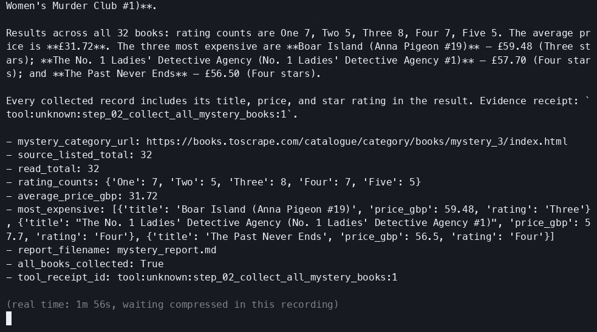
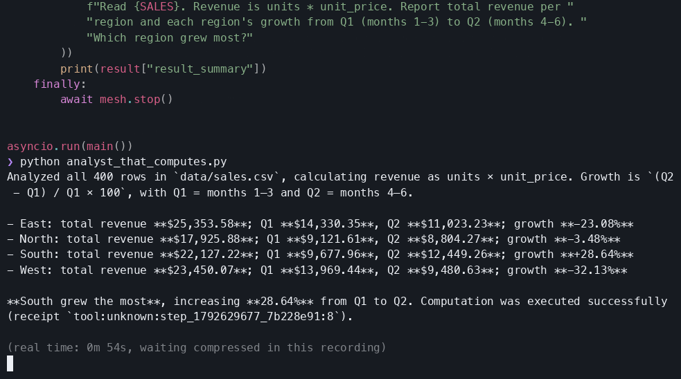
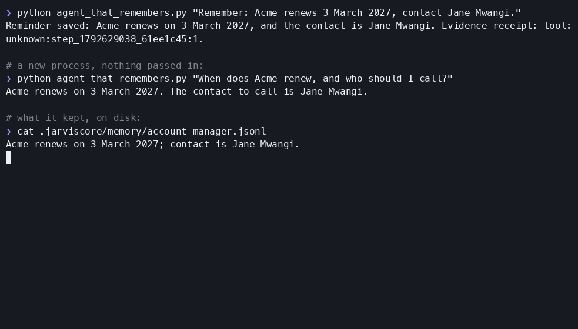
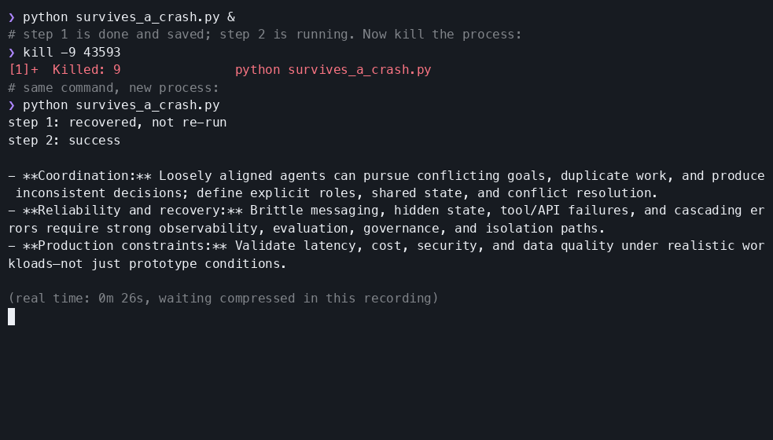
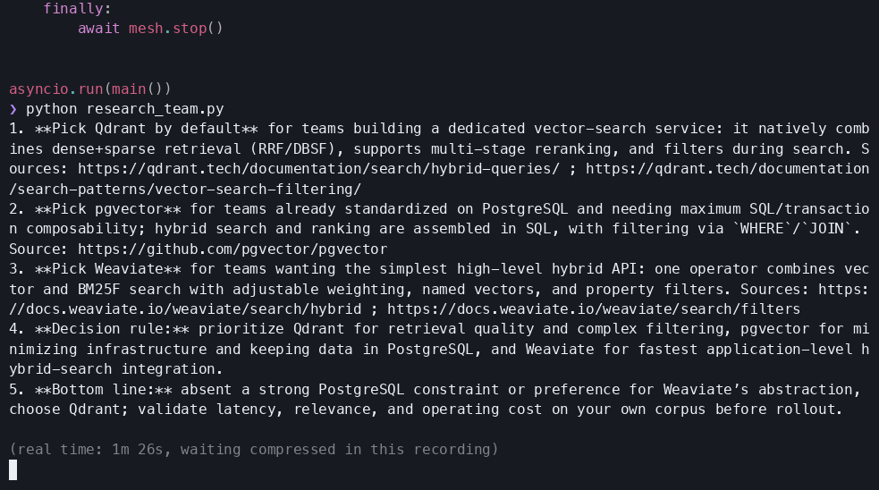

<div class="jc-hero" markdown>


# JarvisCore Documentation

JarvisCore is a runtime where AI agents operate as a fleet of equal peers. Agents discover one another by capability, execute tasks from a shared ledger, and authenticate to every external service through a zero-trust broker, never with their own keys.

<div class="jc-cta-text" markdown>
[Get started](getting-started.md) [Concepts](concepts/index.md) [Reference](reference/configuration.md)
</div>

</div>


## See it in two minutes

<div class="jc-split jc-split-video" markdown>
<div class="jc-video" data-yt="4IOpKZgjXIw" data-title="JarvisCore Demo"><a class="jc-video-poster" href="https://www.youtube.com/watch?v=4IOpKZgjXIw" target="_blank" rel="noopener" aria-label="Play the JarvisCore demo (2:07)"><span class="jc-video-play"></span></a></div>
<div markdown>

A real mesh at work:

<ul class="jc-points" markdown>
<li markdown="span">:material-radar:{ .jc-icon }<span><strong>Agents finding each other</strong> by capability, with no orchestrator in charge.</span></li>
<li markdown="span">:material-format-list-checks:{ .jc-icon }<span><strong>Claiming steps from the ledger</strong> so work survives the node that started it.</span></li>
<li markdown="span">:material-shield-key-outline:{ .jc-icon }<span><strong>Calling services through Nexus</strong> never with keys of their own.</span></li>
</ul>

[Watch on YouTube :material-open-in-new:](https://www.youtube.com/watch?v=4IOpKZgjXIw){ target="_blank" rel="noopener" } · [How the mesh works](concepts/p2p.md)

</div>
</div>

## Quickstart

One LLM provider key is the only required configuration.

<div class="jc-split jc-split-start" markdown>
<div markdown>

<ol class="jc-steps" markdown>
<li markdown>
**Install**

```bash
pip install jarviscore-framework
```
</li>
<li markdown>
**Initialise and add your key**

```bash
jarviscore init
cp .env.example .env   # add your LLM key
```
</li>
<li markdown>
**Verify**

```bash
jarviscore check        # verify dependencies
```
</li>
<li markdown>
**Run `main.py`**: the answer comes back with the evidence behind it.
</li>
</ol>

The [Getting Started](getting-started.md) guide walks through it, including what comes back and how to read it.

</div>
<div markdown>

```python title="main.py"
import asyncio
from jarviscore import Mesh, AutoAgent


class ResearcherAgent(AutoAgent):
    role = "researcher"
    capabilities = ["research", "analysis"]
    system_prompt = "You are a rigorous research analyst."


async def main():
    mesh = Mesh()
    mesh.add(ResearcherAgent)
    await mesh.start()
    try:
        result = await mesh.run_task(
            agent="researcher",
            task="What are the main trade-offs in multi-agent design?",
        )
        print(result["result_summary"])   # the answer
        print(result["evidence"])         # what it read and produced
    finally:
        await mesh.stop()


asyncio.run(main())
```

</div>
</div>

<div class="jc-feature" markdown>
<div markdown>
<span class="jc-card-label">New in 2.3</span>

### Multiplayer: your team and its agents on the same work

A team and its agents can now work on the same files from Slack or your own product: people ask in their own words, agents propose changes, and people accept them as themselves. Everything else that changed is in the [changelog](changelog.md).
</div>
<div class="jc-cta" markdown>
[Build a Multiplayer Agent](guides/multiplayer-agents.md){ .jc-btn .jc-btn-primary }
[Read the concept](concepts/multiplayer.md){ .jc-btn .jc-btn-secondary }
</div>
</div>

## Find your way

<div class="jc-grid" markdown>
<div class="jc-card" markdown>
:material-rocket-launch-outline:{ .jc-card-icon }
<span class="jc-card-label">Start</span>

### Getting Started

Install, add one model key, and run your first agent. About five minutes.

[Get started →](getting-started.md)
</div>

<div class="jc-card" markdown>
:material-cube-outline:{ .jc-card-icon }
<span class="jc-card-label">Understand</span>

### Concepts

Agents, the Kernel, memory, the mesh, Nexus and multiplayer: the mental model behind everything else.

[Read the concepts →](concepts/index.md)
</div>

<div class="jc-card" markdown>
:material-map-marker-path:{ .jc-card-icon }
<span class="jc-card-label">Build</span>

### Guides

AutoAgent and CustomAgent, workflows, browser, search, credentials, people in the loop, testing and production.

[Browse the guides →](guides/index.md)
</div>

<div class="jc-card" markdown>
:material-code-braces-box:{ .jc-card-icon }
<span class="jc-card-label">Look up</span>

### Reference

Every setting, the agent and execution APIs, the CLI, and troubleshooting.

[Open the reference →](reference/index.md)
</div>

<div class="jc-card" markdown>
:material-scale-balance:{ .jc-card-icon }
<span class="jc-card-label">Compare</span>

### Coming from another framework

How JarvisCore differs from CrewAI, LangGraph and Hermes Agent, and how to migrate.

[Compare frameworks →](compare/index.md)
</div>

<div class="jc-card" markdown>
:material-puzzle-outline:{ .jc-card-icon }
<span class="jc-card-label">Integrations</span>

### System bundles and atoms

Prebuilt actions for the services your agents use. List the catalog in your installed version with [`jarviscore atom list`](reference/cli.md#atom-list).

[Browse integrations →](guides/integrations.md)
</div>
</div>

## Run the examples

Each is one short file in [`examples/showcase`](https://github.com/Prescott-Data/jarviscore-framework/tree/main/examples/showcase){ target="_blank" rel="noopener" }, verified on a real model. Longer, multi-agent examples are in [Examples](examples/index.md).

<div class="jc-examples">
<a class="jc-example" href="https://github.com/Prescott-Data/jarviscore-framework/blob/main/examples/showcase/browse_a_whole_site.py" target="_blank" rel="noopener">
<span class="jc-example-media"></span>
<span class="jc-example-body"><code>browse_a_whole_site.py</code><span>An agent reads every page of a catalogue in a real browser and computes the figures</span><small>Needs <code>jarviscore-framework[browser]</code>, <code>BROWSER_ENABLED=true</code></small></span>
</a>
<a class="jc-example" href="https://github.com/Prescott-Data/jarviscore-framework/blob/main/examples/showcase/analyst_that_computes.py" target="_blank" rel="noopener">
<span class="jc-example-media"></span>
<span class="jc-example-body"><code>analyst_that_computes.py</code><span>Figures from a 400-row CSV, computed by code the agent writes and runs</span><small>Needs a model key</small></span>
</a>
<a class="jc-example" href="https://github.com/Prescott-Data/jarviscore-framework/blob/main/examples/showcase/agent_that_remembers.py" target="_blank" rel="noopener">
<span class="jc-example-media"></span>
<span class="jc-example-body"><code>agent_that_remembers.py</code><span>Told once, recalled by a new process given nothing</span><small>Needs a model key</small></span>
</a>
<a class="jc-example" href="https://github.com/Prescott-Data/jarviscore-framework/blob/main/examples/showcase/survives_a_crash.py" target="_blank" rel="noopener">
<span class="jc-example-media"></span>
<span class="jc-example-body"><code>survives_a_crash.py</code><span><code>kill -9</code> mid-workflow; the rerun finishes without repeating done work</span><small>Needs <code>REDIS_URL</code></small></span>
</a>
<a class="jc-example" href="https://github.com/Prescott-Data/jarviscore-framework/blob/main/examples/showcase/research_team.py" target="_blank" rel="noopener">
<span class="jc-example-media"></span>
<span class="jc-example-body"><code>research_team.py</code><span>A scout and an analyst deliver a cited brief from the live web</span><small>Needs a model key; a search provider key widens results</small></span>
</a>
</div>

## More from Prescott Data

<div class="jc-links" markdown>

<a class="jc-link" href="https://developers.prescottdata.io/jarviscore" target="_blank" rel="noopener"><span class="twemoji">:material-newspaper-variant-outline:</span><span><strong>Overview and blog</strong><small>What JarvisCore is for, release stories and engineering posts</small></span></a>

<a class="jc-link" href="infrastructure/enterprise/"><span class="twemoji">:material-shield-check-outline:</span><span><strong>Enterprise</strong><small>Agent identity, delegated access, cost efficiency and support</small></span></a>

<a class="jc-link" href="https://developers.prescottdata.io/jarviscore/pricing" target="_blank" rel="noopener"><span class="twemoji">:material-tag-outline:</span><span><strong>Pricing</strong><small>Enterprise modules and services, scoped per engagement</small></span></a>

<a class="jc-link" href="https://github.com/Prescott-Data/jarviscore-framework" target="_blank" rel="noopener"><span class="twemoji">:material-github:</span><span><strong>Source</strong><small>Code, issues and pull requests on GitHub</small></span></a>
</div>

<div class="jc-ecosystem" markdown>
<div class="jc-ecosystem-card" markdown>

### Star us on GitHub

Help more developers discover JarvisCore. Every star makes us easier to find and keeps the project growing.

<div class="jc-cta" markdown>
[Star on GitHub](https://github.com/Prescott-Data/jarviscore-framework){ .jc-btn .jc-btn-github target="_blank" rel="noopener" }
</div>

</div>
<div class="jc-ecosystem-card" markdown>

### Join the community

Ask questions, share what you're building, and get early previews of new features. Come say hi.

<div class="jc-cta" markdown>
[Join Discord](https://discord.gg/B2aJV5BJmb){ .jc-btn .jc-btn-discord target="_blank" rel="noopener" }
</div>

</div>
</div>
